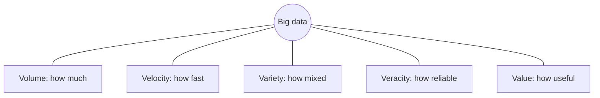

**In simple words:** big data is data that is too large, arrives too fast and is too mixed for one ordinary computer and a normal database to handle. It needs many computers working together (a cluster). <Cite id="big-data-intro-wiki" /> <Cite id="big-data-intro-ibm" />

**Why it is needed:** phones, websites, sensors and cameras create data every second. Hidden in it are useful answers (what a customer will buy, which machine will fail), but only if we can store and process it.

**Characteristics (the V's).** The first three are the classic ones; veracity and value were added later. <Cite id="big-data-intro-gfg" /> <Cite id="big-data-intro-av" />

| V | Meaning | Example |
|---|---|---|
| **Volume** | Amount of data: terabytes to petabytes | Facebook photos and posts |
| **Velocity** | Speed at which data arrives and must be processed | Stock ticks, sensor readings |
| **Variety** | Many formats: tables, text, images, video, logs | Tweets, CCTV video, bank tables |
| **Veracity** | How correct and clean the data is | Fake reviews, noisy sensors |
| **Value** | The useful result we get from it | Better product recommendations |

<Cite id="big-data-intro-gfg" loc="diagram" />

**Applications:** social media analysis, fraud detection in banks, recommendations in online shops, traffic and weather prediction.

**Conclusion:** big data is described by its 5 V's, and because of them it needs distributed storage and processing such as Hadoop.
