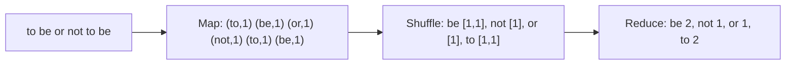

**In simple words:** MapReduce ek bade job ko bahut saare chhote **Map tasks** mein baantta hai jo alag machines pe parallel chalte hain, phir **Reduce tasks** unke results ko jod dete hain. Programmer sirf do functions likhta hai, map aur reduce. Splitting, data move karna, grouping aur failures ka kaam framework karta hai. <Cite id="hadoop-ecosystem-dean2004" /> <Cite id="mapreduce-gfg-mr" />

**Map task.** Ye input ka ek chunk padhta hai aur har record ko zero ya zyada **(key, value)** pairs mein badal deta hai: map(k1, v1) se list of (k2, v2) milti hai. Example: line ke har word ke liye (word, 1) emit karo. Map tasks aapas mein baat nahi karte. <Cite id="hadoop-ecosystem-mmds" loc="§2.2.1" />

**Dono ke beech (shuffle).** Framework map output ko sort karta hai aur ek hi key ki saari values ko saath group karta hai, taaki har key ek hi Reduce task tak pahunche.

**Reduce task.** Ise ek key aur uski saari values ki list milti hai aur ye unhe combine karta hai: reduce(k2, list of v2) se us key ka final result milta hai. Example: 1's ko add karke word count nikaalo. <Cite id="hadoop-ecosystem-mmds" loc="§2.2.3" />

<Sum>

<Given>

Input line: `to be or not to be`.

</Given>

<Find>

har word ka count, map, shuffle aur reduce se.

</Find>

<Steps>

1. **Map.** Har word ke liye ek pair emit karo: (to,1) (be,1) (or,1) (not,1) (to,1) (be,1).
2. **Shuffle.** Key se group karo: be \[1,1\], not \[1\], or \[1\], to \[1,1\].
3. **Reduce.** Har key ki list add karo: be 2, not 1, or 1, to 2.

</Steps>

<Answer>

be 2, not 1, or 1, to 2.

</Answer>

<Box kind="verify">

Counts ka sum $2 + 1 + 1 + 2 = 6$ hai, jo line ke words ki sankhya hai.

</Box>

</Sum>

<Cite id="mapreduce-gfg-wordcount" loc="diagram" />

**Conclusion:** map parallel mein key-value pairs banata hai, reduce ek key ki saari values ko combine karta hai, aur dono milke sasti machines ke cluster pe huge data process karte hain.

Exam mein English mein likho: "Map converts input records into intermediate key-value pairs; reduce merges all values of the same key into the final output."
