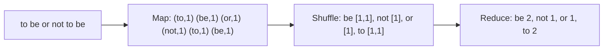

**In simple words:** MapReduce splits a big job into many small **Map tasks** that run in parallel on different machines, then **Reduce tasks** that combine their results. The programmer writes only two functions, map and reduce. The framework does the splitting, moving, grouping and failure handling. <Cite id="hadoop-ecosystem-dean2004" /> <Cite id="mapreduce-gfg-mr" />

**Map task.** It reads one chunk of input and turns every record into zero or more **(key, value)** pairs: map(k1, v1) gives a list of (k2, v2). Example: for each word in a line, emit (word, 1). Map tasks never talk to each other. <Cite id="hadoop-ecosystem-mmds" loc="§2.2.1" />

**Between the two (shuffle).** The framework sorts the map output and groups all values of the same key together, so each key reaches exactly one Reduce task.

**Reduce task.** It receives a key with the list of all its values and combines them: reduce(k2, list of v2) gives the final result for that key. Example: add the 1s to get the word count. <Cite id="hadoop-ecosystem-mmds" loc="§2.2.3" />

<Sum>

<Given>

Input line: `to be or not to be`.

</Given>

<Find>

the count of each word, by map, shuffle and reduce.

</Find>

<Steps>

1. **Map.** Emit one pair per word: (to,1) (be,1) (or,1) (not,1) (to,1) (be,1).
2. **Shuffle.** Group by key: be \[1,1\], not \[1\], or \[1\], to \[1,1\].
3. **Reduce.** Add the list of each key: be 2, not 1, or 1, to 2.

</Steps>

<Answer>

be 2, not 1, or 1, to 2.

</Answer>

<Box kind="verify">

The counts add up to $2 + 1 + 1 + 2 = 6$, the number of words in the line.

</Box>

</Sum>

<Cite id="mapreduce-gfg-wordcount" loc="diagram" />

**Conclusion:** map produces key-value pairs in parallel, reduce combines all values of one key, and together they process huge data on cheap clusters.
