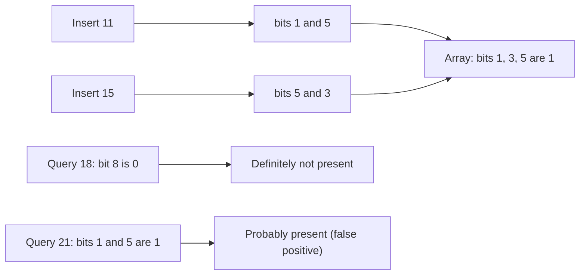

**In simple words:** Bloom filter (Burton Bloom, 1970) bits ka ek chhota array aur $k$ hash functions hai. Ye bahut kam memory mein jaldi bata deta hai "ye item mere set mein hai ya nahi?". Ye kabhi kabhi us item ke liye galat "yes" bol deta hai jo kabhi add hi nahi hua (**false positive**), lekin jo item add hua hai uske liye **kabhi** "no" nahi bolta. <Cite id="stream-counting-mmds-home" loc="§4.3" /> <Cite id="stream-counting-wiki-bloom" />

**Streams mein ye kyun zaroori hai:** items ek baar aate hain aur sab store nahi ho sakte. Example: mail server har sender ko ek arab good addresses ki list se check karta hai. List ko memory mein rakhna bahut bada hai aur disk lookup bahut slow. Bloom filter har address ke liye sirf kuch bits rakhta hai.

**Ye kaise kaam karta hai**

1. $m$ bits se shuru karo, sab 0.
2. **Insert** karne ke liye item pe saare $k$ hash functions lagao aur wo $k$ bits 1 kar do.
3. **Query** ke liye uski $k$ positions nikaalo. Agar koi bhi bit 0 hai, to item **pakka nahi hai**. Agar sab 1 hain, to item **shayad hai**.

<Sum>

<Given>

$m = 10$ bits, $k = 2$ hash functions: $h_1(x) = x \bmod 10$ aur $h_2(x) = (2x + 3) \bmod 10$. 11 aur 15 insert karo. Phir 18 aur 21 query karo.

</Given>

<Find>

bit array, dono queries ke jawab, aur false-positive rate.

</Find>

<Steps>

1. **Insert 11.** $h_1 = 1$, $h_2 = 25 \bmod 10 = 5$. Bits 1 aur 5 set karo.
2. **Insert 15.** $h_1 = 5$, $h_2 = 33 \bmod 10 = 3$. Bits 5 (pehle se 1) aur 3 set karo.
3. **Bit array** (positions 0 se 9): `0 1 0 1 0 1 0 0 0 0`.
4. **Query 18.** $h_1 = 8$, aur bit 8 0 hai, to 18 **pakka nahi hai**.
5. **Query 21.** $h_1 = 1$, $h_2 = 45 \bmod 10 = 5$. Dono bits 1 hain, to jawab "shayad hai". Lekin 21 kabhi insert nahi hua, isliye ye **false positive** hai.
6. **False-positive rate** $\approx \left(1 - e^{-kn/m}\right)^k$, $n = 2$ items ke saath: $\left(1 - e^{-0.4}\right)^2 = (1 - 0.670)^2 \approx 0.109$.

</Steps>

<Answer>

Bits 1, 3 aur 5 set hain. 18 pakka absent hai; 21 false positive hai. False-positive rate lagbhag 0.11 (11 percent).

</Answer>

<Box kind="verify">

Sirf 3 bits set hain (4 nahi) kyunki dono items bit 5 pe takraye. Naya item jiske dono bits un 3 mein hon uski chance $(3/10)^2 = 0.09$, jo formula ke 0.109 ke kareeb hai (formula random hashes maanta hai).

</Box>

</Sum>

<Cite id="stream-counting-gfg-bloom" loc="diagram" />

**Advantages:** bahut kam memory, insert aur query constant time, false negative nahi. **Limits:** false positives, aur items delete nahi ho sakte. **Uses:** spam filters, aur Cassandra aur HBase filter "yahan nahi" bole to disk file skip kar dete hain. <Cite id="stream-counting-cass-bloom" />

**Conclusion:** Bloom filter ek chhoti, control ki hui galat "yes" ki chance ke badle memory mein bahut badi bachat deta hai.

Exam mein English mein likho: "A Bloom filter is a bit array with k hash functions that tests set membership with no false negatives but possible false positives."
