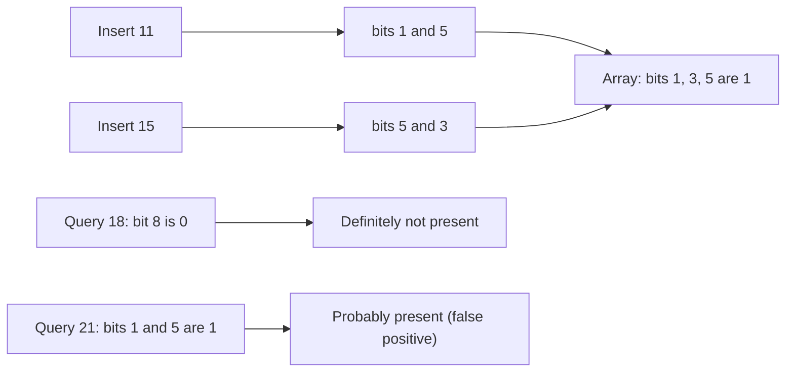

**In simple words:** a Bloom filter (Burton Bloom, 1970) is a small array of bits plus $k$ hash functions. It quickly answers "is this item in my set?" using very little memory. It may wrongly say "yes" for an item that was never added (a **false positive**), but it **never** says "no" for an item that was added. <Cite id="stream-counting-mmds-home" loc="§4.3" /> <Cite id="stream-counting-wiki-bloom" />

**Why it is needed in streams:** items arrive once and cannot all be stored. Example: a mail server checks each sender against a list of a billion good addresses. Keeping the list in memory is too big and a disk lookup is too slow. A Bloom filter keeps a few bits per address.

**How it works**

1. Start with $m$ bits, all 0.
2. **Insert** an item: apply all $k$ hash functions and set those $k$ bits to 1.
3. **Query** an item: compute its $k$ positions. If any bit is 0, the item is **definitely not** in the set. If all are 1, it is **probably** in the set.

<Sum>

<Given>

$m = 10$ bits, $k = 2$ hash functions: $h_1(x) = x \bmod 10$ and $h_2(x) = (2x + 3) \bmod 10$. Insert 11 and 15. Then query 18 and 21.

</Given>

<Find>

the bit array, the answers to both queries, and the false-positive rate.

</Find>

<Steps>

1. **Insert 11.** $h_1 = 1$, $h_2 = 25 \bmod 10 = 5$. Set bits 1 and 5.
2. **Insert 15.** $h_1 = 5$, $h_2 = 33 \bmod 10 = 3$. Set bits 5 (already 1) and 3.
3. **Bit array** (positions 0 to 9): `0 1 0 1 0 1 0 0 0 0`.
4. **Query 18.** $h_1 = 8$, and bit 8 is 0, so 18 is **definitely not** present.
5. **Query 21.** $h_1 = 1$, $h_2 = 45 \bmod 10 = 5$. Both bits are 1, so the answer is "probably present". But 21 was never inserted, so this is a **false positive**.
6. **False-positive rate** $\approx \left(1 - e^{-kn/m}\right)^k$ with $n = 2$ items: $\left(1 - e^{-0.4}\right)^2 = (1 - 0.670)^2 \approx 0.109$.

</Steps>

<Answer>

Bits 1, 3 and 5 are set. 18 is definitely absent; 21 is a false positive. False-positive rate about 0.11 (11 percent).

</Answer>

<Box kind="verify">

Only 3 bits are set (not 4) because both items hit bit 5. A new item with both bits in that set of 3 gives about $(3/10)^2 = 0.09$, close to the formula's 0.109, which assumes random hashes.

</Box>

</Sum>

<Cite id="stream-counting-gfg-bloom" loc="diagram" />

**Advantages:** tiny memory, constant-time insert and query, no false negatives. **Limits:** false positives, and items cannot be deleted. **Uses:** spam filters, and Cassandra and HBase skip disk files when the filter says "not here". <Cite id="stream-counting-cass-bloom" />

**Conclusion:** a Bloom filter trades a small, controllable chance of false "yes" for a huge saving in memory.
