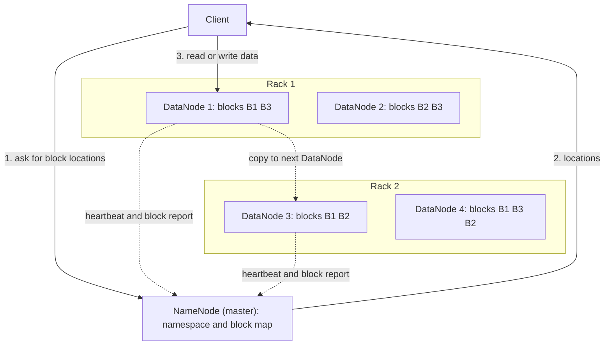

**In simple words:** HDFS (Hadoop Distributed File System) bahut bade files ko blocks mein kaat ke, un blocks ko copies ke saath, bahut saare sasti computers pe phaila deta hai. Iska design **master-slave** hai: ek NameNode (master) aur bahut saare DataNodes (slaves). <Cite id="hdfs-apache-design" /> <Cite id="hdfs-ibm" />

**Ye kyun zaroori hai:** kai terabytes ka file ek disk pe nahi aata, aur ek machine fail hone se data nahi khona chahiye. HDFS commodity hardware pe ek bada, fault-tolerant file system deta hai.

<Cite id="hdfs-apache-design" loc="diagram" /> <Cite id="hdfs-gfg" loc="diagram" />

**Components**

1. **NameNode (master).** **Metadata** rakhta hai: folder tree, har file kin blocks se bani hai, aur har block kin DataNodes pe hai. Ye sab RAM mein rakhta hai aur disk pe **fsimage** (snapshot) aur **edit log** (uske baad ke changes) ke roop mein save karta hai. Ye file ka data kabhi store nahi karta. <Cite id="hdfs-apache-design" />
2. **DataNodes (slaves).** Apni local disks pe asli blocks store karte hain aur read-write requests serve karte hain. Har DataNode har 3 second mein **heartbeat** aur ek **block report** NameNode ko bhejta hai.
3. **Blocks.** File default 128 MB ke blocks mein kati hoti hai. Bade blocks se metadata aur seek time kam hota hai.
4. **Replication.** Har block default mein 3 baar store hota hai: ek copy likhne wale node pe, ek alag rack pe aur ek us rack ke doosre node pe. Ise **rack awareness** kehte hain, taaki poora rack fail ho to bhi data na khoye. <Cite id="hdfs-apache-rack" />
5. **Secondary NameNode.** Samay samay pe edit log ko fsimage mein merge karta hai. Ye checkpoint ka helper hai, hot standby nahi (wo kaam HA mein Standby NameNode ka hai).
6. **Client.** NameNode se block locations leta hai aur phir DataNodes se seedha baat karta hai.

**Read:** client NameNode se poochta hai, block locations paata hai, har block nearest DataNode se padhta hai. **Write:** NameNode DataNodes chunta hai, client block pehle DataNode ko bhejta hai, wo pipeline mein baaki ko aage pass karta hai.

**Failure handling:** jo DataNode 10 minute se zyada (default timeout) heartbeat na bheje use dead maan liya jaata hai aur uske blocks doosri replicas se dobara copy hote hain.

**Advantages:** fault tolerance, petabytes tak scale, sasta hardware, high throughput. **Limits:** bahut saari chhoti files ke liye kharab, low-latency access ke liye nahi, ek NameNode bottleneck ban sakta hai jab tak HA na ho.

**Conclusion:** HDFS metadata ek NameNode pe aur replicated data blocks bahut saare DataNodes pe rakhta hai, jisse big data ke liye bharosemand storage milta hai.

Exam mein English mein likho: "HDFS has a master NameNode that stores metadata and slave DataNodes that store replicated blocks."
