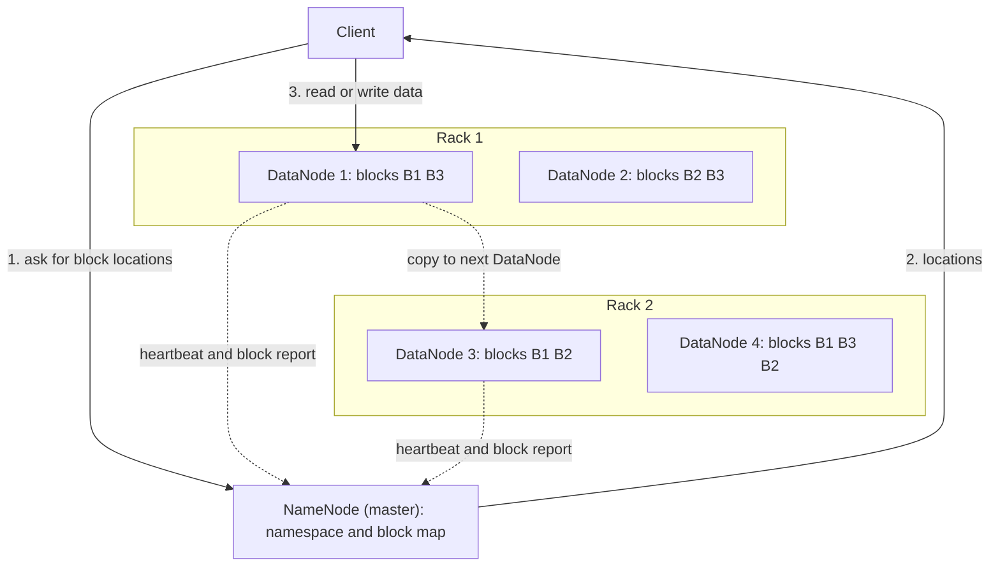

**In simple words:** HDFS (Hadoop Distributed File System) stores very large files by cutting them into blocks and spreading the blocks, with copies, over many cheap computers. It follows a **master-slave** design: one NameNode (master) and many DataNodes (slaves). <Cite id="hdfs-apache-design" /> <Cite id="hdfs-ibm" />

**Why it is needed:** a file of many terabytes does not fit on one disk, and one machine failing must not lose the data. HDFS gives one big, fault-tolerant file system on commodity hardware.

<Cite id="hdfs-apache-design" loc="diagram" /> <Cite id="hdfs-gfg" loc="diagram" />

**Components**

1. **NameNode (master).** Keeps the **metadata**: the folder tree, which blocks make each file, and which DataNodes hold each block. It holds this in RAM and saves it on disk as the **fsimage** (snapshot) and the **edit log** (changes since). It never stores file data. <Cite id="hdfs-apache-design" />
2. **DataNodes (slaves).** Store the actual blocks on their local disks and serve read and write requests. Each sends a **heartbeat** every 3 seconds and a **block report** to the NameNode.
3. **Blocks.** A file is cut into blocks of 128 MB by default. Large blocks mean less metadata and less seek time.
4. **Replication.** Every block is stored 3 times by default: one copy on the writer's node, one on a different rack and one on another node of that rack. This is **rack awareness**, so a whole rack failing does not lose data. <Cite id="hdfs-apache-rack" />
5. **Secondary NameNode.** Periodically merges the edit log into the fsimage. It is a helper for checkpoints, not a hot standby (that role is the Standby NameNode in HA).
6. **Client.** Gets block locations from the NameNode and then talks to the DataNodes directly.

**Read:** client asks the NameNode, gets block locations, reads each block from the nearest DataNode. **Write:** the NameNode picks DataNodes, and the client sends the block to the first, which passes it along a pipeline to the others.

**Failure handling:** a DataNode that sends no heartbeat for over 10 minutes (the default timeout) is marked dead and its blocks are copied again from other replicas.

**Advantages:** fault tolerance, scales to petabytes, cheap hardware, high throughput. **Limits:** poor for many small files, not for low-latency access, single NameNode is a bottleneck unless HA is used.

**Conclusion:** HDFS keeps metadata on one NameNode and data blocks, replicated, on many DataNodes, which gives reliable storage for big data.
