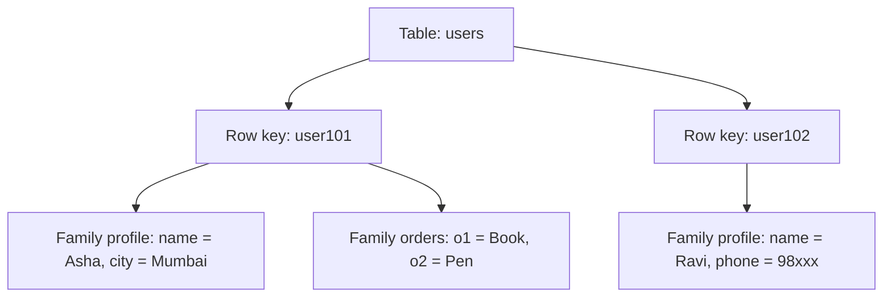
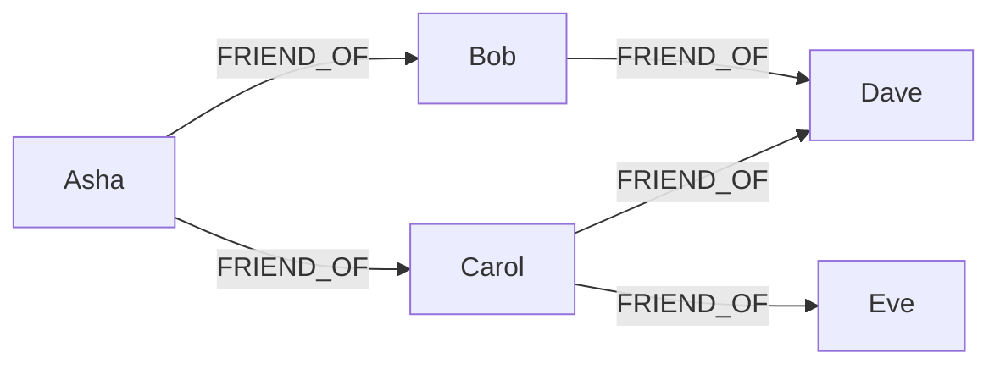

**In simple words:** architectural pattern wo basic tareeka hai jisse NoSQL database apna data organise karta hai. **Column family store** sparse rows ko column families mein group karke rakhta hai. **Graph store** cheezein aur unke beech ke links rakhta hai. <Cite id="nosql-patterns-gfg-types" />

**1. Column family store (wide-column store)**

*Ye kya hai.* Data tables mein rehta hai, lekin har row **row key** se milti hai, aur uske columns **column families** mein group hote hain jo saath store aur read hote hain. Alag rows ke columns alag ho sakte hain, isliye table bahut **sparse** ho sakta hai bina jagah waste kiye. Google Bigtable original hai; HBase aur Cassandra iske baad aaye. Ek cell **timestamp** ke saath kai versions rakh sakta hai. <Cite id="nosql-intro-bigtable" /> <Cite id="nosql-patterns-gfg-col" />

<Cite id="nosql-patterns-gfg-col" loc="diagram" />

| Row key | profile:name | profile:city | profile:phone | orders:o1 |
|---|---|---|---|---|
| user101 | Asha | Mumbai | (empty) | Book |
| user102 | Ravi | (empty) | 98xxx | (empty) |

*Scale kaise hota hai.* Rows key range se (ya Cassandra mein hash se) bahut saare nodes pe baant di jaati hain, aur writes bahut fast hote hain. *Kahan accha:* time series, logs, messaging, web indexing. *Kahan kamzor:* joins aur ad-hoc queries, kyunki tables known queries ke hisaab se design hote hain. *Examples:* HBase, Cassandra. <Cite id="nosql-patterns-cass-model" />

**2. Graph store**

*Ye kya hai.* Data **nodes** (log, products), **edges** ya relationships (FRIEND_OF, BOUGHT) aur **properties** (name, date) ke roop mein rehta hai. Relationships asli links ki tarah store hote hain, isliye query bas unhe follow karti hai, joins nahi lagte. <Cite id="nosql-patterns-neo4j-model" /> <Cite id="nosql-patterns-gfg-graph" />

<Cite id="nosql-patterns-neo4j-model" loc="diagram" />

*Example.* Social network mein friend suggestion: Asha se shuru karo, FRIEND_OF do baar follow karo, phir jinhe wo pehle se jaanti hai unhe hata do. Graph store mein ye ek chhoti traversal hai, lekin SQL mein har hop ke liye join chahiye. *Kahan accha:* social networks, recommendations, fraud detection, routes. *Kahan kamzor:* graph ko bahut machines pe baantna aur bulk reports. *Examples:* Neo4j, Amazon Neptune.

| Point | Column family | Graph |
|---|---|---|
| Stores | Grouped columns wali rows | Nodes aur relationships |
| Strength | Bahut zyada writes, sparse data | Gehri connected queries |
| Query by | Row key (aur columns) | Relationships par chalna |
| Example | Cassandra, HBase | Neo4j |

**Conclusion:** bahut bade, sparse, write-heavy data ke liye column family store use karo, aur jab records ke beech ke links sabse zyada matter karein tab graph store.

Exam mein English mein likho: "A column family store groups columns into families under a row key; a graph store keeps nodes, edges and properties and answers queries by traversal."
