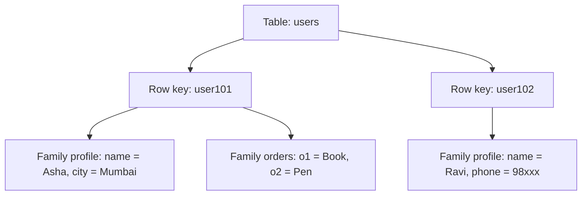
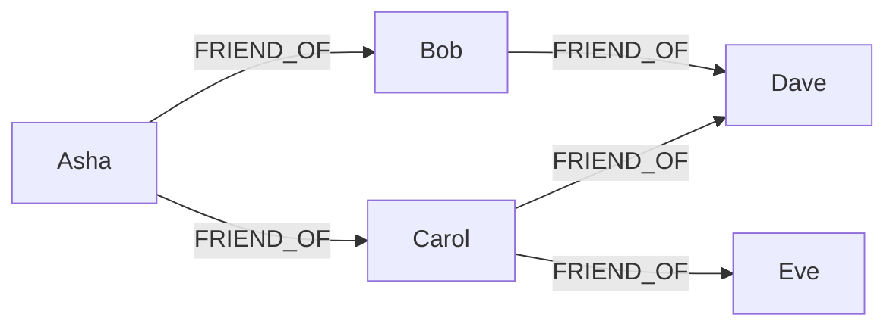

**In simple words:** an architectural pattern is the basic way a NoSQL database organises its data. A **column family store** keeps sparse rows grouped into column families. A **graph store** keeps things and the links between them. <Cite id="nosql-patterns-gfg-types" />

**1. Column family store (wide-column store)**

*What it is.* Data is kept in tables, but each row is found by a **row key**, and its columns are grouped into **column families** that are stored and read together. Different rows may have different columns, so the table can be very **sparse** without wasting space. Google Bigtable is the original; HBase and Cassandra follow it. A cell can keep several versions by **timestamp**. <Cite id="nosql-intro-bigtable" /> <Cite id="nosql-patterns-gfg-col" />

<Cite id="nosql-patterns-gfg-col" loc="diagram" />

| Row key | profile:name | profile:city | profile:phone | orders:o1 |
|---|---|---|---|---|
| user101 | Asha | Mumbai | (empty) | Book |
| user102 | Ravi | (empty) | 98xxx | (empty) |

*How it scales.* Rows are split by key range (or hashed, in Cassandra) over many nodes, and writes are very fast. *Good for:* time series, logs, messaging, web indexing. *Weak at:* joins and ad-hoc queries, because tables are designed around known queries. *Examples:* HBase, Cassandra. <Cite id="nosql-patterns-cass-model" />

**2. Graph store**

*What it is.* Data is kept as **nodes** (people, products), **edges** or relationships (FRIEND_OF, BOUGHT) and **properties** (name, date). Relationships are stored as real links, so a query just follows them instead of doing joins. <Cite id="nosql-patterns-neo4j-model" /> <Cite id="nosql-patterns-gfg-graph" />

<Cite id="nosql-patterns-neo4j-model" loc="diagram" />

*Example.* Friend suggestion in a social network: start at Asha and follow FRIEND_OF twice, then drop people she already knows. This is one short traversal in a graph store, but needs a join per hop in SQL. *Good for:* social networks, recommendations, fraud detection, routes. *Weak at:* spreading the graph over many machines and bulk reports. *Examples:* Neo4j, Amazon Neptune.

| Point | Column family | Graph |
|---|---|---|
| Stores | Rows with grouped columns | Nodes and relationships |
| Strength | Huge write volume, sparse data | Deep connected queries |
| Query by | Row key (and columns) | Walking relationships |
| Example | Cassandra, HBase | Neo4j |

**Conclusion:** use a column family store for huge, sparse, write-heavy data and a graph store when the links between records matter most.
