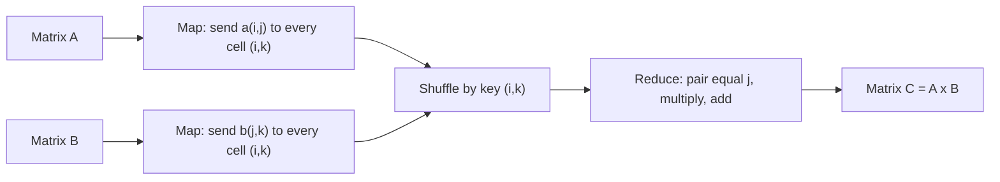

**In simple words:** to multiply $A$ ($I \times J$) by $B$ ($J \times K$), output cell $c_{ik} = \sum_j a_{ij} b_{jk}$ needs row $i$ of $A$ and column $k$ of $B$. In MapReduce we make the **output cell $(i,k)$ the key**, so everything one cell needs meets at one reducer. <Cite id="hadoop-ecosystem-mmds" loc="§2.3.9, §2.3.10" /> <Cite id="mapreduce-algorithms-gfg-matmul" />

**Idea.** Each $a_{ij}$ is needed by every cell in row $i$ of the answer, so map copies it to all $K$ cells. Each $b_{jk}$ is needed by every cell in column $k$, so map copies it to all $I$ cells. A tag ($A$ or $B$) and the shared index $j$ travel with each value.


**Pseudo code**

```text
map(matrix, row, col, value):
    if matrix == A:                        # value = a[i][j], row = i, col = j
        for k in 1..K:
            emit((row, k), ('A', col, value))
    else:                                  # value = b[j][k], row = j, col = k
        for i in 1..I:
            emit((i, col), ('B', row, value))

reduce((i, k), values):
    a = { j: v for ('A', j, v) in values }
    b = { j: v for ('B', j, v) in values }
    emit((i, k), sum(a[j] * b[j] for j in a))
```



<Cite id="mapreduce-algorithms-gfg-matmul" loc="diagram" />

<Sum>

<Given>

$$
A = \begin{bmatrix} 2 & 1 \\ 0 & 3 \end{bmatrix}, \quad B = \begin{bmatrix} 1 & 4 \\ 5 & 2 \end{bmatrix}
$$

</Given>

<Find>

$C = AB$ with the one-step MapReduce method.

</Find>

<Steps>

1. **Map for A.** Each $a_{ij}$ goes to both cells of row $i$, tagged with $j$:

   | $a_{ij}$ | Map output |
   |---|---|
   | $a_{11} = 2$ | ((1,1), (A,1,2)), ((1,2), (A,1,2)) |
   | $a_{12} = 1$ | ((1,1), (A,2,1)), ((1,2), (A,2,1)) |
   | $a_{21} = 0$ | ((2,1), (A,1,0)), ((2,2), (A,1,0)) |
   | $a_{22} = 3$ | ((2,1), (A,2,3)), ((2,2), (A,2,3)) |

2. **Map for B.** Each $b_{jk}$ goes to both cells of column $k$, tagged with $j$:

   | $b_{jk}$ | Map output |
   |---|---|
   | $b_{11} = 1$ | ((1,1), (B,1,1)), ((2,1), (B,1,1)) |
   | $b_{12} = 4$ | ((1,2), (B,1,4)), ((2,2), (B,1,4)) |
   | $b_{21} = 5$ | ((1,1), (B,2,5)), ((2,1), (B,2,5)) |
   | $b_{22} = 2$ | ((1,2), (B,2,2)), ((2,2), (B,2,2)) |

3. **Shuffle and reduce.** Each cell receives two A-values and two B-values. Pair them by $j$, multiply and add:

   | Cell | A-values (j: value) | B-values (j: value) | Sum of products | Result |
   |---|---|---|---|---|
   | (1,1) | 1: 2, 2: 1 | 1: 1, 2: 5 | $2 \times 1 + 1 \times 5 = 2 + 5$ | 7 |
   | (1,2) | 1: 2, 2: 1 | 1: 4, 2: 2 | $2 \times 4 + 1 \times 2 = 8 + 2$ | 10 |
   | (2,1) | 1: 0, 2: 3 | 1: 1, 2: 5 | $0 \times 1 + 3 \times 5 = 0 + 15$ | 15 |
   | (2,2) | 1: 0, 2: 3 | 1: 4, 2: 2 | $0 \times 4 + 3 \times 2 = 0 + 6$ | 6 |

</Steps>

<Answer>

$$
C = \begin{bmatrix} 7 & 10 \\ 15 & 6 \end{bmatrix}
$$

</Answer>

<Box kind="verify">

Check 1: the sum of all entries is $7 + 10 + 15 + 6 = 38$. Column sums of $A$ are $(2, 4)$ and row sums of $B$ are $(5, 7)$, and $2 \times 5 + 4 \times 7 = 10 + 28 = 38$, the same.

Check 2: the two-step method (key $j$ first, then add per cell). For $j = 1$ the products are $2 \times 1, 2 \times 4, 0 \times 1, 0 \times 4 = 2, 8, 0, 0$ for cells (1,1), (1,2), (2,1), (2,2). For $j = 2$ they are $1 \times 5, 1 \times 2, 3 \times 5, 3 \times 2 = 5, 2, 15, 6$. Adding per cell gives $7, 10, 15, 6$, the same matrix.

</Box>

</Sum>

**Two-step variant.** Job 1 uses key $j$ and emits every product $a_{ij} b_{jk}$ with key $(i,k)$; job 2 adds the products of each cell. It copies less data and suits large sparse matrices. <Cite id="hadoop-ecosystem-mmds" loc="§2.3.9, §2.3.10" />

**Conclusion:** with the output cell as key, map copies each element to the cells that need it and reduce does the multiply-and-add, so each cell of $C$ is computed independently in parallel.
