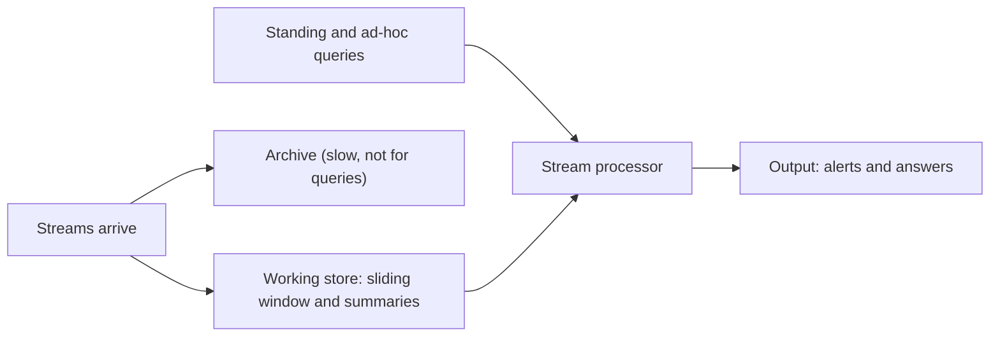

**In simple words:** data stream items (clicks, sensor readings, transactions) ka kabhi na khatam hone wala flow hai jise hum ek hi baar dekhte hain aur poora store nahi kar sakte. Normal database stored, finite data maanta hai, isliye stream pe queries ke jawab dene mein khaas problems aati hain. <Cite id="stream-data-model-babcock2002" /> <Cite id="stream-data-model-ibm" />

**Query ke do type.** **Standing (continuous) query** ek baar poochi jaati hai aur data aate rehne par hamesha jawab deti hai ("temperature 40 se upar ho to alert do"). **Ad-hoc query** ek baar abhi ke baare mein poochi jaati hai ("pichle 5 minute ka maximum kya hai?"). <Cite id="stream-data-model-cs246-slides" />

<Cite id="stream-data-model-gfg-dbms-dsms" loc="diagram" />

**Main issues**

| Issue | Problem kyun hai | Usual remedy |
|---|---|---|
| Unbounded memory | Stream khatam nahi hoti par memory fixed hai | Sirf summary (synopsis) rakho |
| Approximate answers | Exact answer ke liye saara data chahiye | Known error wale answers maano (sampling, sketches) |
| Sliding windows | Purana data count nahi hona chahiye, aur window define karni padti hai (last $N$ items ya last $T$ minutes) | Sirf latest window pe answer do |
| Blocking operators | SUM, COUNT, MAX, sort aur kuch joins ko pehle output se pehle saara input chahiye | Window versions ya running results use karo |
| Past data | Ad-hoc query ko aisa data chahiye ho sakta hai jo guzar chuka | Queries sirf window ya future ke baare mein allow karo, ya summaries rakho |
| Speed and load | Data tezi se aata hai aur uski speed system control nahi karta | Accha scheduling, load shedding (kuch items jaan-bujhkar drop karna) |
| Out-of-order and noisy data | Alag sources ke items late, galat ya missing aate hain | Time stamps, robust queries |

<Cite id="stream-data-model-babcock2002" loc="§4" /> <Cite id="stream-data-model-gfg-dbms-dsms" />

**Example.** Pichle ghante mein product X ki sales count karne ke liye hum har sale hamesha store nahi kar sakte, isliye ek ghante ki window rakhte hain, aur kuch percent ka error chalta hai.

**DBMS versus stream system ek line mein:** DBMS data store karke us pe ek-baar wali queries chalata hai; stream system guzarte data pe permanent queries chalata hai.

**Conclusion:** stream query processing ko fixed memory, ek pass, tez arrival aur approximate answers ke saath kaam karna padta hai, isliye wo stored tables ki jagah windows, summaries aur sampling pe chalta hai.

Exam mein English mein likho: "Stream query processing faces unbounded data, limited memory, blocking operators, need for approximate answers and real-time response."
