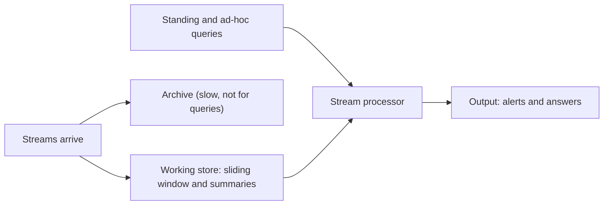

**In simple words:** a data stream is a never-ending flow of items (clicks, sensor readings, transactions) that we see once and cannot store fully. A normal database assumes stored, finite data, so answering queries on a stream raises special problems. <Cite id="stream-data-model-babcock2002" /> <Cite id="stream-data-model-ibm" />

**Two kinds of query.** A **standing (continuous) query** is asked once and answered forever as data arrives ("alert me if temperature is above 40"). An **ad-hoc query** is asked once about now ("what is the maximum in the last 5 minutes?"). <Cite id="stream-data-model-cs246-slides" />

<Cite id="stream-data-model-gfg-dbms-dsms" loc="diagram" />

**Main issues**

| Issue | Why it is a problem | Usual remedy |
|---|---|---|
| Unbounded memory | The stream never ends but memory is fixed | Keep only a summary (synopsis) |
| Approximate answers | Exact answers need all data | Accept answers with a known error (sampling, sketches) |
| Sliding windows | Old data must not count, and a window must be defined (last $N$ items or last $T$ minutes) | Answer over the latest window only |
| Blocking operators | SUM, COUNT, MAX, sort and some joins need all input before the first output | Use window versions or running results |
| Past data | An ad-hoc query may need data that has already passed | Allow queries only about the window or the future, or keep summaries |
| Speed and load | Data arrives fast and at a rate the system does not control | Good scheduling, load shedding (drop some items on purpose) |
| Out-of-order and noisy data | Items from different sources arrive late, wrong or missing | Time stamps, robust queries |

<Cite id="stream-data-model-babcock2002" loc="§4" /> <Cite id="stream-data-model-gfg-dbms-dsms" />

**Example.** To count sales of product X in the last hour we cannot store every sale forever, so we keep a one-hour window, and a count that is a few percent off is acceptable.

**DBMS versus stream system in one line:** a DBMS stores data and runs one-time queries on it; a stream system runs permanent queries on data that passes by.

**Conclusion:** stream query processing must work with fixed memory, one pass, fast arrival and approximate answers, so it relies on windows, summaries and sampling instead of stored tables.
