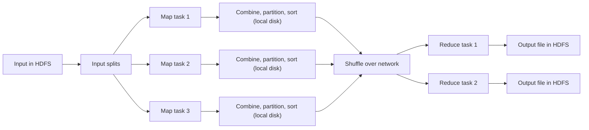

**In simple words:** MapReduce execution pipeline un parts ki chain hai jo job ko HDFS ke input files se HDFS ke output files tak le jaati hai. Components list karne ka matlab har part ka naam aur uska kaam batana. <Cite id="mapreduce-gfg-mr" /> <Cite id="mapreduce-tp" />

<Cite id="mapreduce-gfg-mr" loc="diagram" /> <Cite id="mapreduce-tp" loc="diagram" />

**Main components**

| Component | Function |
|---|---|
| Client | Map aur reduce code package karta hai, input aur output path batata hai, job submit karta hai |
| Resource manager (YARN ResourceManager; Hadoop 1 mein JobTracker) | Cluster resources deta hai aur free nodes dhoondta hai, tarjeeh data ke paas wale |
| Job master (MRAppMaster; book mein "master controller") | Ek job chalata hai: map aur reduce tasks banata hai, assign karta hai, progress track karta hai, failed tasks dobara chalata hai |
| Workers (NodeManager containers; Hadoop 1 mein TaskTracker) | Map aur reduce tasks chalate hain aur heartbeats bhejte hain |
| InputFormat, InputSplit, RecordReader | Input ko splits mein kaatte hain aur har split ko (key, value) records banate hain |
| Mapper | Har record pe map function chalata hai |
| Combiner (optional) | Map output pe mini reduce, taaki data travel se pehle chhota ho jaye |
| Partitioner | Har key ke liye reducer chunta hai, `hash(key) mod R` |
| Shuffle and sort | Har partition ko uske reducer tak copy karta hai aur sorted key groups mein merge karta hai |
| Reducer | Har key group pe reduce function chalata hai |
| OutputFormat and HDFS | Har reducer ke liye ek output file likhte hain |

<Cite id="hadoop-ecosystem-apache-yarn" /> <Cite id="hadoop-ecosystem-dean2004" /> <Cite id="hadoop-ecosystem-mmds" loc="§2.2.4" />

**Execution ka order**

1. Client job submit karta hai aur code cluster pe copy hota hai.
2. Input splits mein katta hai; har split ke liye ek map task chalta hai, tarjeeh us node pe jahan block hai.
3. Har map task apna output memory buffer mein likhta hai, phir local disk pe spill karta hai (partitioned, sorted, combined).
4. Reducers har finished map se apna partition copy karte hain (shuffle) aur sorted groups mein merge karte hain. Reduce tabhi shuru hota hai jab saare maps khatam ho jayein.
5. Reduce har key ke liye ek baar chalta hai aur HDFS mein likhta hai; job master job ko done mark karta hai.

**Fault tolerance:** agar koi worker mar jaye to job master uske tasks doosre node pe dobara chalata hai, kyunki input abhi bhi HDFS mein hai.

**Conclusion:** client, resource manager, job master, workers, partitioner, shuffle aur reducers milke input splits ko apne aap final output mein badal dete hain.

Exam mein English mein likho: "The pipeline is: submit, split, map, combine, partition, shuffle and sort, reduce, write output to HDFS."
