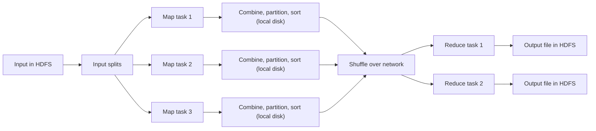

**In simple words:** the MapReduce execution pipeline is the chain of parts that takes a job from input files in HDFS to output files in HDFS. Listing the components means naming each part and what it does. <Cite id="mapreduce-gfg-mr" /> <Cite id="mapreduce-tp" />

<Cite id="mapreduce-gfg-mr" loc="diagram" /> <Cite id="mapreduce-tp" loc="diagram" />

**Main components**

| Component | Function |
|---|---|
| Client | Packages the map and reduce code, names input and output paths, submits the job |
| Resource manager (YARN ResourceManager; JobTracker in Hadoop 1) | Gives out cluster resources and finds free nodes, preferably near the data |
| Job master (MRAppMaster; "master controller" in the book) | Runs one job: creates map and reduce tasks, assigns them, tracks progress, restarts failed tasks |
| Workers (NodeManager containers; TaskTracker in Hadoop 1) | Run the map and reduce tasks and send heartbeats |
| InputFormat, InputSplit, RecordReader | Cut input into splits and turn each into (key, value) records |
| Mapper | Runs the map function on every record |
| Combiner (optional) | Mini reduce on map output to shrink data before it travels |
| Partitioner | Picks the reducer for each key, `hash(key) mod R` |
| Shuffle and sort | Copies each partition to its reducer and merges into sorted key groups |
| Reducer | Runs the reduce function on each key group |
| OutputFormat and HDFS | Write one output file per reducer |

<Cite id="hadoop-ecosystem-apache-yarn" /> <Cite id="hadoop-ecosystem-dean2004" /> <Cite id="hadoop-ecosystem-mmds" loc="§2.2.4" />

**Order of execution**

1. The client submits the job and the code is copied to the cluster.
2. The input is cut into splits; one map task runs per split, preferably on the node holding the block.
3. Each map task writes its output to a memory buffer, then spills it to local disk (partitioned, sorted, combined).
4. Reducers copy their partition from every finished map (shuffle) and merge it into sorted groups. Reduce starts only after all maps finish.
5. Reduce runs once per key and writes to HDFS; the job master marks the job done.

**Fault tolerance:** if a worker dies, the job master re-runs its tasks on another node, because the input is still in HDFS.

**Conclusion:** the client, resource manager, job master, workers, partitioner, shuffle and reducers together turn input splits into final output automatically.
