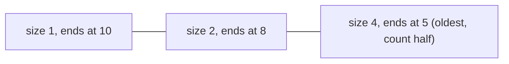

**In simple words:** hamare paas 0 aur 1 ki stream hai aur humein pichle $N$ bits mein 1's ki ginti chahiye. Exact counting ke liye saare $N$ bits memory mein chahiye. **DGIM algorithm** (Datar, Gionis, Indyk, Motwani, 2002) sirf lagbhag $\log N$ **buckets** rakhta hai, har bucket 1's ke ek group ka summary hai, aur $O(\log^2 N)$ bits mein sach ke 50 percent ke andar jawab deta hai. <Cite id="stream-counting-mmds-home" loc="§4.6" /> <Cite id="stream-counting-wiki-dsm" />

**Buckets.** Bucket apni **size** (1's ki sankhya, hamesha 2 ki power) aur apne sabse recent 1 ka **timestamp** rakhta hai. Rules:

1. Bucket ka right end ek 1 hota hai.
2. Window ka har 1 theek ek bucket mein hota hai.
3. Har size ke ek ya do buckets hote hain.
4. Peeche jaate hue sizes kabhi kam nahi hoti.
5. Jis bucket ka timestamp window se bahar nikal jaye wo hata diya jaata hai.

**Time $t$ pe bit aane par update**

1. Sabse purana bucket hatao agar uska timestamp $\le t - N$ hai.
2. 0 aaye to aur kuch nahi badalta.
3. 1 aaye to size 1 aur timestamp $t$ ka naya bucket banta hai.
4. Agar ab teen buckets ki size same hai, to **do sabse purane** ko merge karke double size ka ek bucket banao (timestamp unme se naye wale ka). Agli size ke liye dohrao.

**Pichle $N$ bits ke liye query:** window ko overlap karne wale sabse purane bucket $B$ se naye saare buckets ki sizes add karo, phir **$B$ ki size ka aadha** add karo. Sach jawab "naye buckets + 1" aur "naye buckets + $B$ ki size" ke beech hota hai, isliye error $B$ ke aadhe se zyada nahi, aur $B$ kabhi sach count ke aadhe se zyada nahi hota, isliye error 50 percent se kam hai. <Cite id="stream-counting-mmds-home" loc="§4.6" />

<Sum>

<Given>

Stream (time 1 pehle): `1 0 1 1 1 0 1 1 0 1` (10 bits). Window $N = 8$. Bucket ko (size, timestamp) likhte hain.

</Given>

<Find>

har 1 ke baad buckets, aur pichle 8 bits mein 1's ka estimate.

</Find>

<Steps>

1. Update rules lagao (zeros kuch nahi badalte, isliye sirf 1's dikhaye hain):

   | $t$ | Buckets after (newest first) | Why |
   |---|---|---|
   | 1 | (1,1) | naya bucket |
   | 3 | (1,3) (1,1) | size 1 ke do allowed hain |
   | 4 | (1,4) (2,3) | size 1 ke teen, to (1,3) aur (1,1) merge hoke (2,3) |
   | 5 | (1,5) (1,4) (2,3) | |
   | 7 | (1,7) (2,5) (2,3) | size 1 ke teen, to (1,5) aur (1,4) merge hoke (2,5) |
   | 8 | (1,8) (1,7) (2,5) (2,3) | |
   | 10 | (1,10) (2,8) (4,5) | (1,8) aur (1,7) merge hoke (2,8); phir size 2 ke teen, to (2,5) aur (2,3) merge hoke (4,5) |

2. $t = 10$ pe window mein time 3 se 10 hain (timestamp $10 - 8 = 2$ se upar).
3. Window ko overlap karne wala sabse purana bucket $B = (4,5)$ hai. Isse naye buckets: $1 + 2 = 3$.
4. $B$ ka aadha add karo: $4 / 2 = 2$. Estimate $= 3 + 2 = 5$.

</Steps>

<Answer>

Final buckets (1,10) (2,8) (4,5). Pichle 8 bits mein 1's ka estimate $= 5$.

</Answer>

<Box kind="verify">

Seedha ginti: time 3 se 10 ke bits 1 1 1 0 1 1 0 1 hain, jisme chhe 1's hain, to sach jawab 6 hai aur estimate 5 mein 1 ka farak hai (lagbhag 17 percent, 50 percent bound ke andar). Buckets mein $1 + 2 + 4 = 7$ ones hain, jo stream ke saaton 1's (times 1, 3, 4, 5, 7, 8, 10) ke barabar hai. Bucket (4,5) times 1, 3, 4, 5 ke 1's cover karta hai, jinme se sirf teen window ke andar hain, aur 4 ka aadha 2 ka andaza lagata hai.

</Box>

</Sum>

<Cite id="stream-counting-cs246-slides" loc="diagram" />

**Advantages:** bahut kam memory, fast update, guaranteed error bound. **Disadvantages:** jawab sirf approximate hai, aur plain DGIM sirf 0/1 streams ke liye hai.

**Conclusion:** DGIM $N$ bits ki window ko lagbhag $\log N$ buckets se badal deta hai aur phir bhi window counts ko known error ke andar batata hai. <Cite id="stream-counting-wiki-streaming" />

Exam mein English mein likho: "DGIM keeps buckets whose sizes are powers of two, at most two of each size, and estimates the count as the newer buckets plus half of the oldest bucket."
