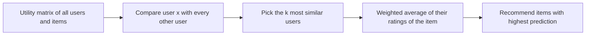

**In simple words:** collaborative filtering (CF) items ko recommend karta hai **sirf bahut saare users ki ratings** se, items ke baare mein koi facts use kiye bina. Idea ye hai ki jo log pehle agree karte the wo aage bhi agree karenge. User $x$ ko wo milta hai jo **$x$ jaise users** ko pasand aaya. <Cite id="recommendation-systems-wiki-cf" /> <Cite id="recommendation-systems-google-cf" /> <Cite id="recommendation-systems-mmds-slides" />

**Analogy.** Aapko aur aapki friend Riya ko wahi chaar films pasand aayi thi. Use paanchvi pasand aayi, to aap uspe bharosa karke wo dekhte ho.

**Data jo use hota hai:** **utility matrix**, users aur items ka table jisme ratings hoti hain, zyadatar khaali.

**Steps (user-user CF)**

1. User $x$ ki ratings se sabse milti julti ratings wale users dhoondo (set $N$), cosine ya Pearson (centered cosine) similarity se.
2. $x$ ki unseen item ki rating $N$ ki ratings ke similarity-weighted average se predict karo: $r_{xi} = \dfrac{\sum_{y \in N} s_{xy} r_{yi}}{\sum_{y \in N} s_{xy}}$.
3. Sabse zyada prediction wale items recommend karo.

**Item-item CF** wahi kaam similar items ke saath karta hai: $x$ ne jo items rate kiye unke jaise items dhoondo aur $x$ ki unki apni ratings ka average lo.

<Cite id="recommendation-systems-mmds-slides" loc="diagram" /> <Cite id="recommendation-systems-google-cf" loc="diagram" />

<Sum>

<Given>

Ratings (khaali = rate nahi kiya). Centered-cosine similarity se Alice ki M4 ki rating predict karo.

| User | M1 | M2 | M3 | M4 |
| --- | --- | --- | --- | --- |
| Alice | 5 | 3 | 4 | ? |
| Bob | 5 | 2 | 4 | 5 |
| Carol | 1 | 5 | 3 | 3 |
| Dan | 4 | 3 | 5 | 4 |

</Given>

<Find>

Alice ki M4 ki predicted rating.

</Find>

<Steps>

1. Row averages: Alice 4, Bob 4, Carol 3, Dan 4. Inhe subtract karo (centering); Alice ka blank 0 rehta hai. Alice $(1, -1, 0, 0)$, Bob $(1, -2, 0, 1)$, Carol $(-2, 2, 0, 0)$, Dan $(0, -1, 1, 0)$.
2. Alice ke saath similarity: Bob $= 3/(\sqrt{2}\sqrt{6}) \approx 0.866$; Carol $= -4/(\sqrt{2}\sqrt{8}) = -1$; Dan $= 1/(\sqrt{2}\sqrt{2}) = 0.5$.
3. Do sabse similar users, Bob aur Dan, lo (Carol ki pasand ulti hai).
4. Prediction $= \dfrac{0.866 \times 5 + 0.5 \times 4}{0.866 + 0.5} = \dfrac{6.33}{1.366} \approx 4.63$.

</Steps>

<Answer>

Alice ke liye M4 ki predicted rating $\approx 4.63$, isliye M4 strong recommendation hai.

</Answer>

<Box kind="verify">

Jawab neighbours ki ratings 4 aur 5 ke beech hona chahiye, aur Bob ke 5 ke zyada paas kyunki Bob zyada similar hai: 4.63 aisa hi hai. Unweighted average $(5 + 4)/2 = 4.5$ thoda kam hai, jaisa hona chahiye.

</Box>

</Sum>

**Content-based filtering se kaise alag hai**

| Point | Content-based | Collaborative filtering |
|---|---|---|
| Uses | Item **properties** aur user ki apni history | Sirf **bahut users ki ratings** |
| Idea | Jo pasand aaya uske jaise items | Milti julti rating pattern wale users ya items |
| Item features chahiye | Haan | Nahi |
| Doosre users chahiye | Nahi | Haan, bahut saare |
| New item | Features pata hon to turant recommend ho sakta hai | Nahi, jab tak koi rate na kare |
| New user | Nahi (profile nahi) | Nahi (history nahi) |
| Variety | Kam, over-specialise karta hai | Zyada, surprise de sakta hai |
| Example | Pandora song attributes match karta hai | Amazon "customers who bought this also bought" |

<Cite id="recommendation-systems-gfg-cb" /> <Cite id="recommendation-systems-av" />

**CF ki limits:** cold-start problem aur sparse matrix. Real systems aksar dono methods milate hain (hybrid).

**Conclusion:** collaborative filtering crowd ki ratings se recommend karta hai, content-based item features se; har ek doosre ki kamzori theek karta hai.

Exam mein English mein likho: "Collaborative filtering uses ratings of similar users, whereas content-based filtering uses item features and the user's own profile."
