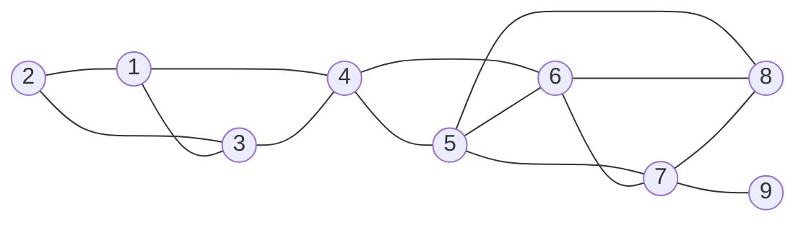
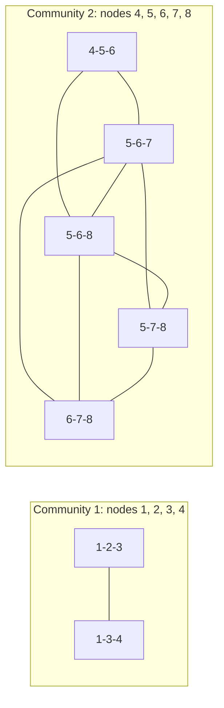

**In simple words:** **Clique Percolation Method (CPM)** chhote cliques ko jodkar graph mein communities dhoondta hai. **$k$-clique** $k$ nodes ka wo group hai jisme har pair connected ho ($k = 3$ ke liye triangle). Do $k$-cliques **adjacent** hote hain agar wo $k-1$ nodes share karein. Community wo sab hai jahan adjacent $k$-cliques ke beech hop karke pahunch sakte hain. <Cite id="social-network-graphs-palla2005" /> <Cite id="social-network-graphs-wiki-cpm" />

**Ye kyun zaroori hai:** asli zindagi mein ek insaan kai groups ka hota hai (ghar, college, hobby). CPM communities ko **overlap** hone deta hai, jo Girvan-Newman jaise methods nahi karte. <Cite id="social-network-graphs-cs224w-overlap" />

**Analogy.** Graph pe ek triangle ka stamp ghumao: do corners fix rakho aur teesra naye node pe swing karo. Stamp jahan tak pahunch sake wo ek community hai.

**Algorithm (CPM)**, input graph $G$ aur integer $k \ge 3$:

1. $G$ ke saare $k$-cliques dhoondo.
2. **Clique graph** banao: har $k$-clique ke liye ek node, aur do cliques ke beech edge agar wo $k-1$ nodes share karein.
3. Clique graph ke connected components dhoondo.
4. Ek component ke cliques ke nodes ka union ek community hai.
5. Jo node kai components ke cliques mein ho wo overlap node hai. Jo node kisi $k$-clique mein nahi wo kisi community mein nahi.

**Diya hua graph:** nodes 1 se 9 aur edges 1-2, 1-3, 1-4, 2-3, 3-4, 4-5, 4-6, 5-6, 5-7, 5-8, 6-7, 6-8, 7-8, 7-9. $k = 3$ lo.

<Cite id="social-network-graphs-wiki-cpm" loc="diagram" />

<Sum>

<Given>

Upar wala graph, $k = 3$.

</Given>

<Find>

3-cliques aur CPM se mili communities.

</Find>

<Steps>

1. **Saare triangles dhoondo.** \{1, 2, 3\}, \{1, 3, 4\}, \{4, 5, 6\}, \{5, 6, 7\}, \{5, 6, 8\}, \{5, 7, 8\}, \{6, 7, 8\}. Yani 7 triangles. Node 9 ka sirf ek edge (7-9) hai, isliye wo kisi triangle mein nahi.
2. **Jo triangles $k - 1 = 2$ nodes share karein unhe link karo.** \{1, 2, 3\} aur \{1, 3, 4\} 1 aur 3 share karte hain. \{4, 5, 6\} aur \{5, 6, 7\} 5 aur 6 share karte hain. Triangles \{5, 6, 7\}, \{5, 6, 8\}, \{5, 7, 8\} aur \{6, 7, 8\} aapas mein do do nodes share karte hain (jaise \{5, 6, 7\} aur \{6, 7, 8\} 6 aur 7 share karte hain), isliye ye \{4, 5, 6\} wali chain mein judte hain.
3. \{1, 3, 4\} aur \{4, 5, 6\} sirf node 4 share karte hain (ek node, do nahi), isliye ye **linked nahi** hain.
4. **Clique graph ke components.** Pehla: \{1, 2, 3\} aur \{1, 3, 4\}. Doosra: \{4, 5, 6\}, \{5, 6, 7\}, \{5, 6, 8\}, \{5, 7, 8\}, \{6, 7, 8\}.
5. **Nodes ka union.** Community 1 $= \{1, 2, 3, 4\}$. Community 2 $= \{4, 5, 6, 7, 8\}$.

</Steps>

<Answer>

Do communities: \{1, 2, 3, 4\} aur \{4, 5, 6, 7, 8\}. Node 4 dono mein hai (overlap). Node 9 kisi mein nahi.

</Answer>

<Box kind="verify">

Triangles ginne ka doosra tareeka: \{5, 6, 7, 8\} mein saare 6 possible edges hain, to ye 4-clique hai jisme $\binom{4}{3} = 4$ triangles hain. Isme \{4, 5, 6\}, \{1, 2, 3\} aur \{1, 3, 4\} jodo to $4 + 3 = 7$, step 1 se match. $k = 4$ lene par sirf ek 4-clique \{5, 6, 7, 8\} hai, to ek hi community milti.

</Box>

</Sum>

<Cite id="social-network-graphs-cs224w-overlap" loc="diagram" />

**$k$ chunna:** bada $k$ kam, ghane communities deta hai; $k = 3$ aam shuruaat hai. **Limits:** bade graphs mein cliques dhoondna slow ho sakta hai, aur kisi $k$-clique se bahar ke nodes (jaise 9) chhoot jaate hain. <Cite id="social-network-graphs-networkx-kclique" />

**Conclusion:** CPM do nodes share karne wale triangles ko communities mein badalta hai; yahan ye \{1, 2, 3, 4\} aur \{4, 5, 6, 7, 8\} deta hai jo node 4 pe overlap karte hain.

Exam mein English mein likho: "CPM finds all k-cliques, links cliques sharing k-1 nodes, and reports each connected group of cliques as a community; communities may overlap."
