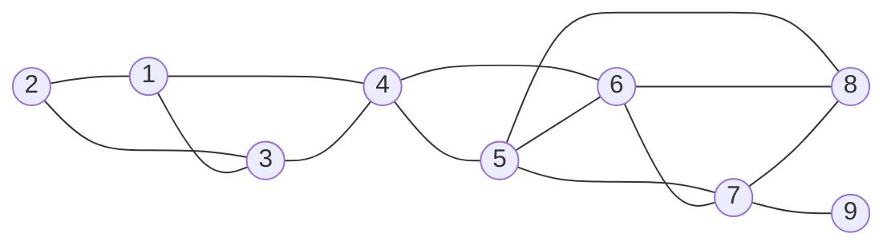
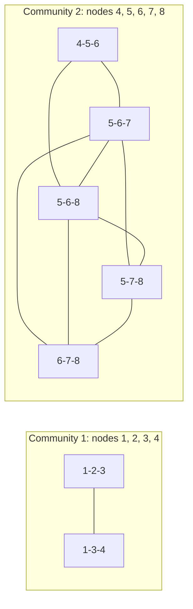

**In simple words:** the **Clique Percolation Method (CPM)** finds communities in a graph by joining small cliques. A **$k$-clique** is a group of $k$ nodes where every pair is connected (for $k = 3$, a triangle). Two $k$-cliques are **adjacent** if they share $k-1$ nodes. A community is everything reachable by hopping between adjacent $k$-cliques. <Cite id="social-network-graphs-palla2005" /> <Cite id="social-network-graphs-wiki-cpm" />

**Why it is needed:** in real life a person belongs to several groups (home, college, hobby). CPM allows communities to **overlap**, which methods like Girvan-Newman do not. <Cite id="social-network-graphs-cs224w-overlap" />

**Analogy.** Roll a triangular stamp over the graph: keep two corners fixed and swing the third to a new node. Everything the stamp can reach is one community.

**Algorithm (CPM)** with input graph $G$ and integer $k \ge 3$:

1. Find all $k$-cliques of $G$.
2. Build a **clique graph**: one node per $k$-clique, with an edge between two cliques if they share $k-1$ nodes.
3. Find the connected components of the clique graph.
4. The union of the nodes of the cliques in one component is one community.
5. A node in cliques of several components is an overlap node. A node in no $k$-clique belongs to no community.

**The given graph** has nodes 1 to 9 and edges 1-2, 1-3, 1-4, 2-3, 3-4, 4-5, 4-6, 5-6, 5-7, 5-8, 6-7, 6-8, 7-8, 7-9. Take $k = 3$.

<Cite id="social-network-graphs-wiki-cpm" loc="diagram" />

<Sum>

<Given>

The graph above with $k = 3$.

</Given>

<Find>

the 3-cliques and the communities found by CPM.

</Find>

<Steps>

1. **Find all triangles.** \{1, 2, 3\}, \{1, 3, 4\}, \{4, 5, 6\}, \{5, 6, 7\}, \{5, 6, 8\}, \{5, 7, 8\}, \{6, 7, 8\}. That is 7 triangles. Node 9 has one edge only (7-9), so it is in no triangle.
2. **Link triangles that share $k - 1 = 2$ nodes.** \{1, 2, 3\} and \{1, 3, 4\} share 1 and 3. \{4, 5, 6\} and \{5, 6, 7\} share 5 and 6. Triangles \{5, 6, 7\}, \{5, 6, 8\}, \{5, 7, 8\} and \{6, 7, 8\} share two nodes with one another (for example \{5, 6, 7\} and \{6, 7, 8\} share 6 and 7), so they join the same chain as \{4, 5, 6\}.
3. \{1, 3, 4\} and \{4, 5, 6\} share only node 4 (one node, not two), so they are **not** linked.
4. **Components of the clique graph.** First: \{1, 2, 3\} and \{1, 3, 4\}. Second: \{4, 5, 6\}, \{5, 6, 7\}, \{5, 6, 8\}, \{5, 7, 8\}, \{6, 7, 8\}.
5. **Union of nodes.** Community 1 $= \{1, 2, 3, 4\}$. Community 2 $= \{4, 5, 6, 7, 8\}$.

</Steps>

<Answer>

Two communities: \{1, 2, 3, 4\} and \{4, 5, 6, 7, 8\}. Node 4 is in both (overlap). Node 9 is in none.

</Answer>

<Box kind="verify">

Another way to count triangles: \{5, 6, 7, 8\} has all 6 possible edges, so it is a 4-clique holding $\binom{4}{3} = 4$ triangles. Add \{4, 5, 6\}, \{1, 2, 3\} and \{1, 3, 4\} to get $4 + 3 = 7$, matching step 1. With $k = 4$ the only 4-clique is \{5, 6, 7, 8\}, so you would get one community.

</Box>

</Sum>

<Cite id="social-network-graphs-cs224w-overlap" loc="diagram" />

**Choosing $k$:** a bigger $k$ gives fewer, denser communities; $k = 3$ is the usual start. **Limits:** finding cliques can be slow on big graphs, and nodes outside any $k$-clique (like 9) are left out. <Cite id="social-network-graphs-networkx-kclique" />

**Conclusion:** CPM turns triangles that share two nodes into communities; here it finds \{1, 2, 3, 4\} and \{4, 5, 6, 7, 8\} overlapping at node 4.
