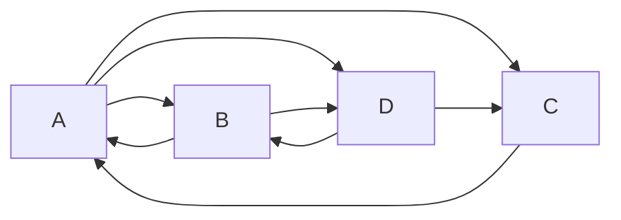

**In simple words:** PageRank (Page aur Brin, 1998) har web page ko ek score deta hai ki wo kitna important hai. Page tab important hai jab important pages usse link karein. Ek **random surfer** socho jo har baar koi random out-link click karta hai; wo jis page pe jitna time bitata hai wahi uska PageRank hai. <Cite id="hadoop-ecosystem-mmds" loc="§5.1" /> <Cite id="mapreduce-algorithms-wiki-pagerank" />

**Ye kyun zaroori hai:** sirf words se search karne par spam milta hai. Links votes ki tarah kaam karte hain, aur important page ka vote zyada ginta hai. PageRank results ko isi importance se rank karta hai.

**Ye kaise kaam karta hai.** $n_j$ out-links wala page apni rank ka $1/n_j$ hissa har linked page ko deta hai. **Transition matrix** $M$ banao: $m_{ij} = 1/n_j$ agar page $j$ page $i$ ko link karta hai, nahi to 0. Rank vector $r$ rakho, $r = (1/n, \dots, 1/n)$ se shuru karo aur $r \leftarrow M r$ tab tak dohrao jab tak wo badalna band na kare. Limit $r = Mr$ satisfy karti hai. Har iteration ek matrix-vector multiplication hai, isliye ye MapReduce mein fit hota hai. <Cite id="pagerank-cs246-pagerank" />

<Cite id="mapreduce-algorithms-gfg-pagerank" loc="diagram" />

<Sum>

<Given>

Upar wala chaar-page web, starting ranks har ek $1/4$.

</Given>

<Find>

do iterations ke baad ranks, aur limit.

</Find>

<Steps>

1. Out-links se equations: $r_A = r_B/2 + r_C$; $r_B = r_A/3 + r_D/2$; $r_C = r_A/3 + r_D/2$; $r_D = r_A/3 + r_B/2$.
2. **Iteration 1**, $(1/4, 1/4, 1/4, 1/4)$ se: $r_A = 1/8 + 1/4 = 3/8$; $r_B = 1/12 + 1/8 = 5/24$; $r_C = 5/24$; $r_D = 1/12 + 1/8 = 5/24$.
3. **Iteration 2:** $r_A = 5/48 + 5/24 = 15/48$; $r_B = 1/8 + 5/48 = 11/48$; $r_C = 11/48$; $r_D = 1/8 + 5/48 = 11/48$.
4. **Limit.** Total 1 ke saath $r = Mr$ solve karo: $r_B = r_C = r_D$ aur $r_A = r_B/2 + r_C = 1.5\, r_B$, to $1.5 r_B + 3 r_B = 1$, jisse $r_B = 2/9$ aur $r_A = 3/9$.

</Steps>

<Answer>

iteration 2 ke baad: $A = 15/48 \approx 0.313$, $B = C = D = 11/48 \approx 0.229$. Limit: $A = 3/9$, $B = C = D = 2/9$.

</Answer>

<Box kind="verify">

Ranks ka total hamesha 1 rehta hai: $3/8 + 3 \times 5/24 = 9/24 + 15/24 = 1$, aur $15/48 + 3 \times 11/48 = 48/48 = 1$. Limit har equation satisfy karti hai: $r_A = 1/9 + 2/9 = 3/9$ aur $r_B = 1/9 + 1/9 = 2/9$. Iteration 2 pehle se hi 0.333 aur 0.222 ki taraf badh rahi hai.

</Box>

</Sum>

**Asli web ki problems**

- **Dead end:** wo page jiska **koi out-link nahi**. Uski rank ke jaane ki jagah nahi, wo system se leak ho jaati hai, aur saari ranks 0 ki taraf jaati hain. Example: A, B aur C ko link karta hai; B, A aur C ko; C kisi ko nahi; har ek $1/3$ se shuru karo, to ek step ke baad total $2/3$ aur phir $1/3$ ho jaata hai.
- **Spider trap:** pages ka group jiske out-links **group ke andar hi** rehte hain (sabse simple: page jo sirf khud ko link kare). Ye saari rank absorb kar lete hain. Example: A, B aur C ko link karta hai, B, A ko, C, C ko; ranks $(1/3, 1/3, 1/3)$, $(1/3, 1/6, 1/2)$, $(1/6, 1/6, 2/3)$ jaate hain aur trap C ke paas aakhir mein rank 1 hoti hai. <Cite id="pagerank-wiki-spidertrap" />

**Fix: taxation (teleporting).** Probability $\beta$ (lagbhag 0.8 se 0.9) se surfer link follow karta hai, aur probability $1-\beta$ se random page pe jump karta hai: $r \leftarrow \beta M r + (1-\beta)\dfrac{e}{n}$, jahan $e$ 1's ka vector hai. Isse traps saari rank absorb nahi kar paate aur dead ends ko nikalne ka raasta milta hai (unki rank saare pages mein baant di jaati hai). <Cite id="hadoop-ecosystem-mmds" loc="§5.1.5" />

**Advantages:** cheat karna mushkil, offline kaam karta hai aur kisi bhi query ke liye. **Limits:** purane pages ko favour karta hai, aur bade web pe bahut iterations chahiye.

**Conclusion:** PageRank page ko uss pe link karne wale pages ki importance se score karta hai, repeated matrix-vector multiplication se, aur taxation dead ends aur spider traps ko sambhalta hai.

Exam mein English mein likho: "PageRank is the steady-state probability of a random surfer, computed by repeated multiplication r = Mr, with taxation to handle dead ends and spider traps."
