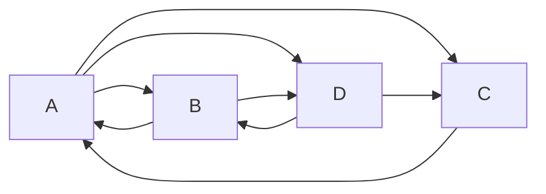

**In simple words:** PageRank (Page and Brin, 1998) gives every web page a score for how important it is. A page is important if important pages link to it. Imagine a **random surfer** who keeps clicking a random out-link; the fraction of time spent on a page is its PageRank. <Cite id="hadoop-ecosystem-mmds" loc="§5.1" /> <Cite id="mapreduce-algorithms-wiki-pagerank" />

**Why it is needed:** searching by words alone returns spam. Links work like votes, and a vote from an important page counts more. PageRank ranks results by this importance.

**How it works.** A page with $n_j$ out-links gives $1/n_j$ of its rank to each page it links to. Build the **transition matrix** $M$ with $m_{ij} = 1/n_j$ if page $j$ links to page $i$, else 0. Keep a rank vector $r$, start with $r = (1/n, \dots, 1/n)$ and repeat $r \leftarrow M r$ until it stops changing. The limit satisfies $r = Mr$. Each iteration is a matrix-vector multiplication, so it fits MapReduce. <Cite id="pagerank-cs246-pagerank" />

<Cite id="mapreduce-algorithms-gfg-pagerank" loc="diagram" />

<Sum>

<Given>

The four-page web above, starting ranks $1/4$ each.

</Given>

<Find>

ranks after two iterations, and the limit.

</Find>

<Steps>

1. Equations from out-links: $r_A = r_B/2 + r_C$; $r_B = r_A/3 + r_D/2$; $r_C = r_A/3 + r_D/2$; $r_D = r_A/3 + r_B/2$.
2. **Iteration 1** from $(1/4, 1/4, 1/4, 1/4)$: $r_A = 1/8 + 1/4 = 3/8$; $r_B = 1/12 + 1/8 = 5/24$; $r_C = 5/24$; $r_D = 1/12 + 1/8 = 5/24$.
3. **Iteration 2:** $r_A = 5/48 + 5/24 = 15/48$; $r_B = 1/8 + 5/48 = 11/48$; $r_C = 11/48$; $r_D = 1/8 + 5/48 = 11/48$.
4. **Limit.** Solve $r = Mr$ with the total 1: $r_B = r_C = r_D$ and $r_A = r_B/2 + r_C = 1.5\, r_B$, so $1.5 r_B + 3 r_B = 1$, giving $r_B = 2/9$ and $r_A = 3/9$.

</Steps>

<Answer>

after iteration 2: $A = 15/48 \approx 0.313$, $B = C = D = 11/48 \approx 0.229$. Limit: $A = 3/9$, $B = C = D = 2/9$.

</Answer>

<Box kind="verify">

The ranks always add to 1: $3/8 + 3 \times 5/24 = 9/24 + 15/24 = 1$, and $15/48 + 3 \times 11/48 = 48/48 = 1$. The limit satisfies every equation: $r_A = 1/9 + 2/9 = 3/9$ and $r_B = 1/9 + 1/9 = 2/9$. Iteration 2 is already moving towards 0.333 and 0.222.

</Box>

</Sum>

**Problems on the real web**

- **Dead end:** a page with **no out-links**. Its rank has nowhere to go and leaks out of the system, so all ranks drift to 0. Example: A links to B and C, B links to A and C, C links to nothing; starting at $1/3$ each, the total after one step is $2/3$ and then $1/3$.
- **Spider trap:** a group of pages whose out-links stay **inside the group** (the simplest is a page linking only to itself). They absorb all the rank. Example: A links to B and C, B links to A, C links to C; ranks go $(1/3, 1/3, 1/3)$, $(1/3, 1/6, 1/2)$, $(1/6, 1/6, 2/3)$ and the trap C ends with rank 1. <Cite id="pagerank-wiki-spidertrap" />

**Fix: taxation (teleporting).** With probability $\beta$ (about 0.8 to 0.9) the surfer follows a link, and with probability $1-\beta$ jumps to a random page: $r \leftarrow \beta M r + (1-\beta)\dfrac{e}{n}$, where $e$ is a vector of 1s. This stops traps from absorbing everything and gives dead ends a way out (their rank is spread over all pages). <Cite id="hadoop-ecosystem-mmds" loc="§5.1.5" />

**Advantages:** hard to cheat, works offline and for any query. **Limits:** favours old pages, and many iterations are needed on a huge web.

**Conclusion:** PageRank scores a page by the importance of pages linking to it, computed by repeated matrix-vector multiplication with taxation to handle dead ends and spider traps.
