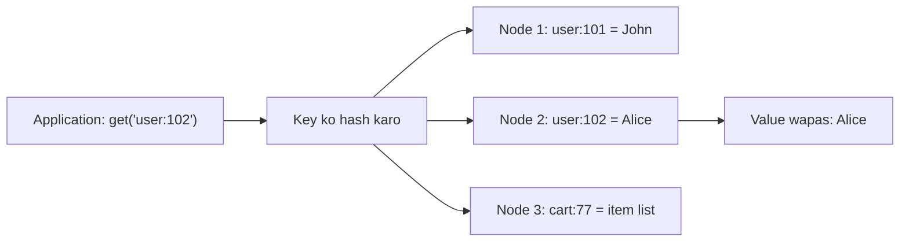

**In simple words:** architectural pattern matlab NoSQL database apna data kaise organise karta hai. McCreary aur Kelly chaar patterns batate hain: **key-value store, document store, column-family store aur graph store**. Ye answer pehle do ko discuss karta hai. <Cite id="nosql-patterns-gfg-types" /> <Cite id="big-data-intro-nosql" />

**Key-value store.** Sabse simple pattern, ek bahut bade dictionary jaisa jo kai machines par faila hota hai. Har item ki ek **unique key** aur ek **value** hoti hai. Database value ke andar kabhi nahi dekhta; wo bas ek blob hai. Sirf `put(key, value)`, `get(key)` aur `delete(key)` chahiye. <Cite id="nosql-patterns-aws-kv" /> <Cite id="nosql-patterns-redis-kv" />



<Cite id="nosql-patterns-gfg-kv" loc="diagram" />

- **Characteristics:** bahut fast single lookup, no joins, keys hash karke aasan scale-out, fixed schema nahi. Kamzori: data sirf key se milta hai.
- **Use cases:** web sessions, shopping carts, caching, leaderboards.
- **Examples:** Redis, Amazon DynamoDB, Riak.

**Document store.** Har record ek **document** hai, aam taur par JSON, jo apne field names khud rakhta hai aur nested fields aur lists hold kar sakta hai. Key-value store se alag, database iske **andar dekh sakta hai**, isliye kisi bhi field par query aur index ho sakta hai. Documents ke group ko **collection** kehte hain, aur uske documents mein same fields hona zaroori nahi. <Cite id="nosql-patterns-mongo-doc" /> <Cite id="nosql-patterns-aws-doc" />

```json
{ "_id": 1, "customer": { "name": "Asha", "city": "Mumbai" },
  "items": [ { "product": "Book", "qty": 2 } ] }
```

<Cite id="nosql-patterns-gfg-doc" />

- **Characteristics:** flexible schema, nested data, kisi bhi field par query, ek document hi store aur copy hone ki unit hai. Kamzori: repeated data har jagah update karna padta hai, aur joins kamzor hain.
- **Use cases:** product catalogues, user profiles, content management.
- **Examples:** MongoDB, CouchDB, Amazon DocumentDB.

| Point | Key-value | Document |
|---|---|---|
| Value | Opaque blob | Structured JSON jise database samajhta hai |
| Query | Sirf key se | Key ya kisi bhi field se |
| Update | Poori value replace | Sirf ek field badlo |
| Best for | Sessions, cache | Catalogues, profiles |

**Conclusion:** key-value sabse zyada speed aur simplicity deta hai; document flexible data par behtar queries deta hai.

Exam mein English mein likho: "The architectural patterns in NoSQL are key-value, document, column-family and graph stores."
