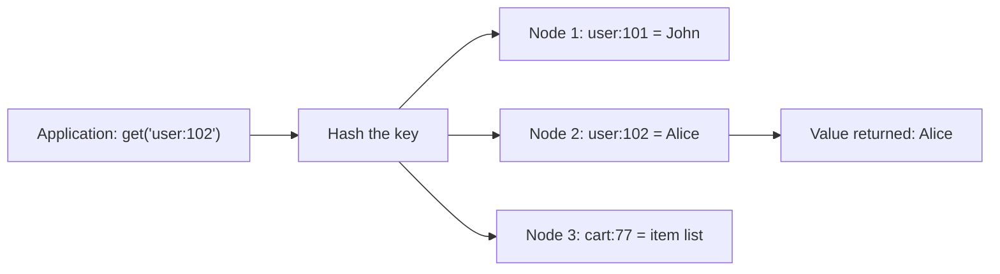

**In simple words:** an architectural pattern is the way a NoSQL database organises its data. McCreary and Kelly name four: **key-value store, document store, column-family store and graph store**. This answer discusses the first two. <Cite id="nosql-patterns-gfg-types" /> <Cite id="big-data-intro-nosql" />

**Key-value store.** The simplest pattern, like a giant dictionary spread over many machines. Each item has a **unique key** and a **value**. The database never looks inside the value; it is just a blob. Only `put(key, value)`, `get(key)` and `delete(key)` are needed. <Cite id="nosql-patterns-aws-kv" /> <Cite id="nosql-patterns-redis-kv" />



<Cite id="nosql-patterns-gfg-kv" loc="diagram" />

- **Characteristics:** very fast single lookup, no joins, easy scale-out by hashing keys, no fixed schema. Weakness: it finds data only by key.
- **Use cases:** web sessions, shopping carts, caching, leaderboards.
- **Examples:** Redis, Amazon DynamoDB, Riak.

**Document store.** Each record is a **document**, usually JSON, that carries its own field names and can hold nested fields and lists. Unlike a key-value store, the database **can look inside** it, so you can query and index any field. A group of documents is a **collection**, and its documents need not have the same fields. <Cite id="nosql-patterns-mongo-doc" /> <Cite id="nosql-patterns-aws-doc" />

```json
{ "_id": 1, "customer": { "name": "Asha", "city": "Mumbai" },
  "items": [ { "product": "Book", "qty": 2 } ] }
```

<Cite id="nosql-patterns-gfg-doc" />

- **Characteristics:** flexible schema, nested data, queries on any field, one document is the unit stored and copied. Weakness: repeated data must be updated everywhere, and joins are weak.
- **Use cases:** product catalogues, user profiles, content management.
- **Examples:** MongoDB, CouchDB, Amazon DocumentDB.

| Point | Key-value | Document |
|---|---|---|
| Value | Opaque blob | Structured JSON the database understands |
| Query | Only by key | By key or any field |
| Update | Replace the whole value | Change a single field |
| Best for | Sessions, cache | Catalogues, profiles |

**Conclusion:** key-value gives the highest speed and simplicity; document gives richer queries on flexible data.
