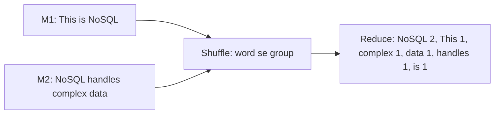

**In simple words:** word count MapReduce ka "hello world" hai. **Map** function har word ke liye `(word, 1)` emit karta hai. Framework same words ko group karta hai (shuffle). **Reduce** function har word ke 1s ko jodta hai. <Cite id="mapreduce-gfg-wordcount" /> <Cite id="hadoop-ecosystem-dean2004" />

**Pseudo code**

```
map(key, value):            // key = line offset, value = text ki ek line
    for each word w in value:
        emit(w, 1)

reduce(key, values):        // key = ek word, values = 1s ki list (ya partial counts)
    sum = 0
    for each v in values:
        sum = sum + v
    emit(key, sum)
```

<Cite id="hadoop-ecosystem-apache-mr-tutorial" />

<Sum>

<Given>

Document: "This is NoSQL. NoSQL handles complex data." Maan lo (aur justify karo) ki punctuation hata diya gaya, words case sensitive hain, aur har sentence apne map task ko jaata hai.

</Given>

<Find>

map output, shuffle groups aur final word counts.

</Find>

<Steps>

1. **Map.** Har word ke liye ek `(word, 1)` pair. *Reason: map har dekhe gaye word par 1 emit karta hai.*

   | Map task | Input | Map output |
   |---|---|---|
   | M1 | This is NoSQL | (This,1) (is,1) (NoSQL,1) |
   | M2 | NoSQL handles complex data | (NoSQL,1) (handles,1) (complex,1) (data,1) |

2. **Shuffle and sort.** Saare pairs ikatthe karo, key se group karo aur keys sort karo. *Reason: ek word ki saari values ek hi reducer tak pahunchni chahiye.*

   | Key | Grouped values |
   |---|---|
   | NoSQL | [1, 1] |
   | This | [1] |
   | complex | [1] |
   | data | [1] |
   | handles | [1] |
   | is | [1] |

3. **Reduce.** Har key ki values ko jodo.

</Steps>

<Answer>

(NoSQL, 2), (This, 1), (complex, 1), (data, 1), (handles, 1), (is, 1).

</Answer>

<Box kind="verify">

Document mein 7 words hain, aur counts ka jod $2 + 1 + 1 + 1 + 1 + 1 = 7$ hai, yaani koi word nahi khoya. Aankh se ginne par bhi sirf NoSQL do baar aata hai.

</Box>

</Sum>



<Cite id="mapreduce-av" loc="diagram" />

**Conclusion:** programmer sirf map aur reduce likhta hai; splitting, shuffle aur sorting framework karta hai.

Exam mein English mein likho: "Map emits (word, 1) for every word; reduce sums the values of each word."
