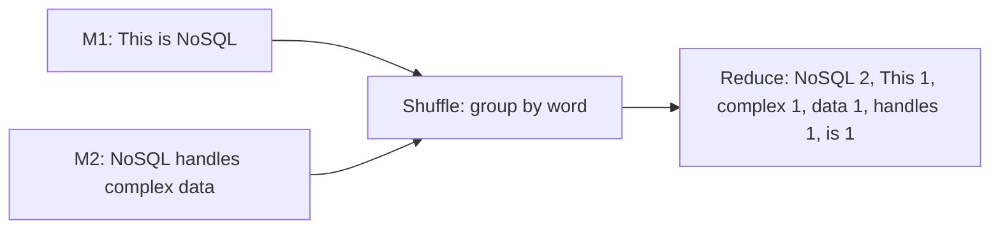

**In simple words:** word count is the "hello world" of MapReduce. The **map** function emits `(word, 1)` for every word. The framework groups equal words (shuffle). The **reduce** function adds the 1s of each word. <Cite id="mapreduce-gfg-wordcount" /> <Cite id="hadoop-ecosystem-dean2004" />

**Pseudo code**

```
map(key, value):            // key = line offset, value = one line of text
    for each word w in value:
        emit(w, 1)

reduce(key, values):        // key = a word, values = list of 1s (or partial counts)
    sum = 0
    for each v in values:
        sum = sum + v
    emit(key, sum)
```

<Cite id="hadoop-ecosystem-apache-mr-tutorial" />

<Sum>

<Given>

Document: "This is NoSQL. NoSQL handles complex data." Assume (and justify) that punctuation is removed, words are case sensitive, and each sentence goes to its own map task.

</Given>

<Find>

the map output, the shuffle groups and the final word counts.

</Find>

<Steps>

1. **Map.** One `(word, 1)` pair for each word. *Reason: map emits a 1 per word seen.*

   | Map task | Input | Map output |
   |---|---|---|
   | M1 | This is NoSQL | (This,1) (is,1) (NoSQL,1) |
   | M2 | NoSQL handles complex data | (NoSQL,1) (handles,1) (complex,1) (data,1) |

2. **Shuffle and sort.** Collect all pairs, group by key and sort the keys. *Reason: every value of one word must reach the same reducer.*

   | Key | Grouped values |
   |---|---|
   | NoSQL | [1, 1] |
   | This | [1] |
   | complex | [1] |
   | data | [1] |
   | handles | [1] |
   | is | [1] |

3. **Reduce.** Add the values of each key.

</Steps>

<Answer>

(NoSQL, 2), (This, 1), (complex, 1), (data, 1), (handles, 1), (is, 1).

</Answer>

<Box kind="verify">

The document has 7 words, and the counts add to $2 + 1 + 1 + 1 + 1 + 1 = 7$, so no word was lost. Counting by eye, only NoSQL appears twice.

</Box>

</Sum>



<Cite id="mapreduce-av" loc="diagram" />

**Conclusion:** the programmer writes only map and reduce; the framework does the splitting, shuffle and sorting.
