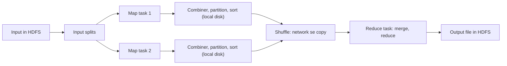

**In simple words:** MapReduce job ek fixed pipeline mein chalta hai. Input split hota hai, **map** tasks har split ko `(key, value)` pairs mein badalte hain, pairs key se group hote hain (**shuffle**), aur **reduce** tasks har group ko final answer mein jodte hain. <Cite id="mapreduce-gfg-mr" /> <Cite id="hadoop-ecosystem-dean2004" />

<Cite id="mapreduce-gfg-mr" loc="diagram" />

**Execution ke steps.** <Cite id="mapreduce-tp" /> <Cite id="hadoop-ecosystem-apache-mr-tutorial" />

1. **Submit.** Client job submit karta hai; cluster manager ek job master start karta hai.
2. **Split.** Input splits mein kata jaata hai, har split ke liye ek map task, data ke paas lagaya jaata hai.
3. **Map.** Har map task apne records padhta hai aur `(key, value)` pairs emit karta hai.
4. **Combine, partition, sort.** Optional combiner pairs ko local level par jodta hai. Partitioner har key ka reducer chunta hai, $\text{hash}(key) \bmod R$.
5. **Shuffle.** Har reducer har mapper se apna hissa copy karta hai.
6. **Reduce.** Reducer keys ko sorted groups mein merge karta hai aur har group par reduce chalata hai. Ye sabhi maps khatam hone ke baad hi shuru hota hai.
7. **Output.** Results HDFS mein likhe jaate hain, har reducer ke liye ek file.

<Sum>

<Given>

Combiner aur ek reducer ke saath word count. Split 1: "big data big". Split 2: "data big tools".

</Given>

<Find>

har stage ka output.

</Find>

<Steps>

1. **Map.** Split 1: (big,1) (data,1) (big,1). Split 2: (data,1) (big,1) (tools,1).
2. **Combiner.** Split 1: (big,2) (data,1). Split 2 mein repeat nahi hai, to wahi rehta hai. Shuffle hone wale pairs: $2 + 3 = 5$, 6 ke bajaye.
3. **Shuffle and sort.** big: [2, 1], data: [1, 1], tools: [1].
4. **Reduce.** Har list ko jodo.

</Steps>

<Answer>

big 3, data 2, tools 1.

</Answer>

<Box kind="verify">

Input mein 6 words hain aur $3 + 2 + 1 = 6$. Seedhi ginti: big split 1 mein 2 baar aur split 2 mein 1 baar, yaani 3.

</Box>

</Sum>

**Conclusion:** splitting, scheduling, shuffle aur failures framework sambhalta hai, isliye programmer sirf map aur reduce likhta hai.

Exam mein English mein likho: "The MapReduce pipeline is input split, map, combine and partition, shuffle and sort, reduce, and output to HDFS."
