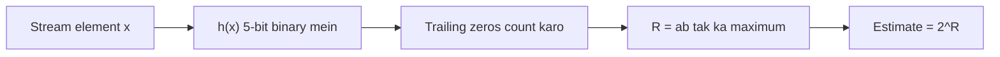

**In simple words:** **Flajolet-Martin (FM)** algorithm bahut kam memory se batata hai ki stream mein kitne distinct elements hain. Har element ko binary number mein hash karo aur uske **trailing zeros** (right end ke zeros) count karo. Sabse bada count $R$ maano. Estimate hai $2^R$. <Cite id="stream-counting-fm1985" /> <Cite id="stream-counting-gfg-fm" />

**Ye kaam kyun karta hai.** Random hash value ke kam se kam $r$ zeros par khatam hone ki probability $1/2^r$ hoti hai. To $r$ trailing zeros wali value dikhe, matlab lagbhag $2^r$ alag elements hash hue honge. <Cite id="stream-counting-mmds-home" loc="§4.4" />

<Cite id="stream-counting-gfg-fm" loc="diagram" />

<Sum>

<Given>

Stream 9, 8, 7, 6, 5, 4, 3, 2. Hash $h(x) = (2x + 1) \bmod 32$, 5 bits mein likha hua.

</Given>

<Find>

distinct elements ka estimate.

</Find>

<Steps>

1. **Hash karo aur binary mein likho.** *Reason: FM hash ke bit pattern par kaam karta hai.*

   | $x$ | $h(x) = (2x+1) \bmod 32$ | 5-bit binary | Trailing zeros |
   |---|---|---|---|
   | 9 | 19 | 10011 | 0 |
   | 8 | 17 | 10001 | 0 |
   | 7 | 15 | 01111 | 0 |
   | 6 | 13 | 01101 | 0 |
   | 5 | 11 | 01011 | 0 |
   | 4 | 9 | 01001 | 0 |
   | 3 | 7 | 00111 | 0 |
   | 2 | 5 | 00101 | 0 |

2. **Maximum.** $R = 0$.
3. **Estimate.** $2^R = 2^0 = 1$.

</Steps>

<Answer>

FM estimate **1** distinct element hai, jabki stream mein sach mein 8 hain.

</Answer>

<Box kind="verify">

Binary check: $19 = 16 + 2 + 1 = 10011$, $13 = 8 + 4 + 1 = 01101$, $5 = 4 + 1 = 00101$. Kharab result ki wajah: $2x + 1$ hamesha odd hota hai, isliye last bit hamesha 1 hai aur trailing zeros kabhi nahi aate. Achhe hash ko random jaisa dikhna chahiye. Compare karne ke liye, $x$ ki seedhi 5-bit value lein to trailing zeros 0, 3, 0, 1, 0, 2, 0, 1 aate hain, to $R = 3$ aur estimate $2^3 = 8$ (ittefaq se sahi; itne chhote stream par FM bas rough hota hai).

</Box>

</Sum>

**Limitation aur fix.** Ek hash ek rough estimate deta hai jo bahut galat ho sakta hai. Practice mein kai hashes use hote hain aur unke estimates ko groups mein average karke median liya jaata hai. <Cite id="stream-counting-mmds-home" loc="§4.4" /> <Cite id="stream-counting-wiki-fm" />

**Conclusion:** yahan diya gaya hash sirf odd numbers banata hai, isliye FM 1 estimate karta hai, jo asli count 8 se bahut door hai.

Exam mein English mein likho: "The Flajolet-Martin estimate is 2 to the power R, where R is the maximum number of trailing zeros in the hashed values."
