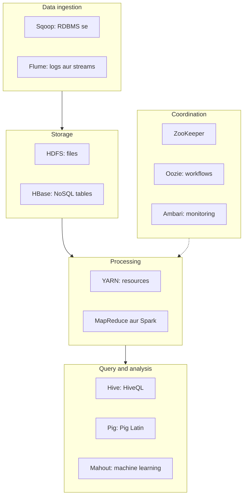

**In simple words:** Hadoop ecosystem un tools ka parivaar hai jo Hadoop ke core (HDFS storage, YARN resource management, MapReduce processing) ke around bane hain. Core data store aur process karta hai, lekin ek real project ko loading, querying, scheduling aur coordination bhi chahiye, aur har tool ek gap bharta hai. <Cite id="hadoop-ecosystem-gfg-hadoop-ecosystem" /> <Cite id="hadoop-ecosystem-av-hadoop-ecosystem" />

<Cite id="hadoop-ecosystem-gfg-hadoop-ecosystem" loc="diagram" />

**Do components ki explanation**

**1. HDFS (Hadoop Distributed File System), storage layer.** HDFS bahut bade files ko kai sasti machines par store karta hai. File blocks mein kati jaati hai (default 128 MB), aur har block teen DataNodes par copy hota hai. Ek **NameNode** metadata rakhta hai (kaunse blocks se kaunsi file bani aur wo kahan hain); **DataNodes** blocks store karte hain aur heartbeat bhejte hain. DataNode mar jaaye to NameNode uske blocks dusri replicas se dobara copy karwa deta hai. Ye bade files ke liye theek hai jo ek baar likhe aur kai baar padhe jaate hain, bahut saari chhoti files ke liye nahi. <Cite id="hdfs-apache-design" />

**2. Hive, SQL layer.** Hive logon ko HDFS ke data par **HiveQL** se query karne deta hai, jo SQL jaisi language hai, Java MapReduce code likhne ki jagah. Hive table definitions **metastore** mein rakhta hai, aur engine har query ko jobs mein badal deta hai jo cluster par chalte hain. Ye bade data ke batch analysis (reports, summaries) ke liye hai, tez single-row updates ke liye nahi. Example: `SELECT city, COUNT(*) FROM orders GROUP BY city;` <Cite id="hadoop-ecosystem-apache-hive" />

| Point | HDFS | Hive |
|---|---|---|
| Layer | Storage | Query |
| Kispar kaam | Files aur blocks | Files ke upar tables |
| Kaun use karta hai | Baaki sab tools | SQL jaanne wale analysts |

**Conclusion:** HDFS reliable storage deta hai aur Hive aasan querying; baaki ecosystem tools loading, processing aur coordination sambhalte hain.

Exam mein English mein likho: "HDFS stores data as replicated blocks across DataNodes under one NameNode; Hive provides SQL-like querying (HiveQL) over data in HDFS."
