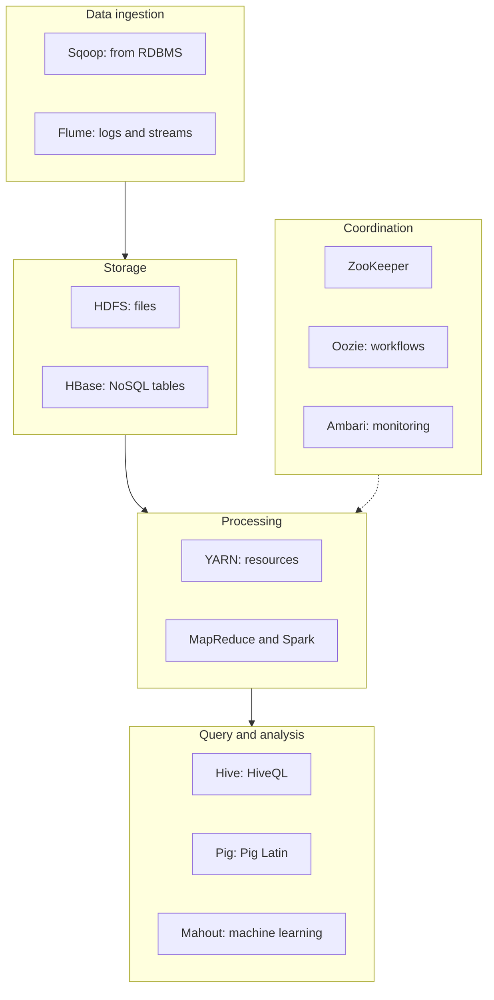

**In simple words:** the Hadoop ecosystem is the family of tools built around Hadoop's core (HDFS storage, YARN resource management, MapReduce processing). The core stores and processes data, but a real project also needs loading, querying, scheduling and coordination, and each tool fills one gap. <Cite id="hadoop-ecosystem-gfg-hadoop-ecosystem" /> <Cite id="hadoop-ecosystem-av-hadoop-ecosystem" />

<Cite id="hadoop-ecosystem-gfg-hadoop-ecosystem" loc="diagram" />

**Two components explained**

**1. HDFS (Hadoop Distributed File System), the storage layer.** HDFS stores very large files across many cheap machines. A file is cut into blocks (128 MB by default), and each block is copied to three DataNodes. A single **NameNode** keeps the metadata (which blocks make which file, and where they are); **DataNodes** store the blocks and send heartbeats. If a DataNode dies, the NameNode re-copies its blocks from the other replicas. It suits big files written once and read many times, not many small files. <Cite id="hdfs-apache-design" />

**2. Hive, the SQL layer.** Hive lets people query data in HDFS with **HiveQL**, a language like SQL, instead of writing Java MapReduce code. Hive keeps the table definitions in a **metastore**, and the engine turns each query into jobs that run on the cluster. It is meant for batch analysis of large data (reports, summaries), not for fast single-row updates. Example: `SELECT city, COUNT(*) FROM orders GROUP BY city;` <Cite id="hadoop-ecosystem-apache-hive" />

| Point | HDFS | Hive |
|---|---|---|
| Layer | Storage | Query |
| Works on | Files and blocks | Tables over files |
| Used by | Every other tool | Analysts who know SQL |

**Conclusion:** HDFS gives reliable storage and Hive gives easy querying; the other ecosystem tools handle loading, processing and coordination.
