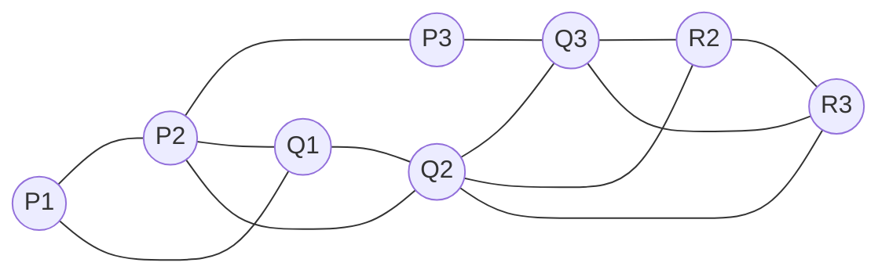
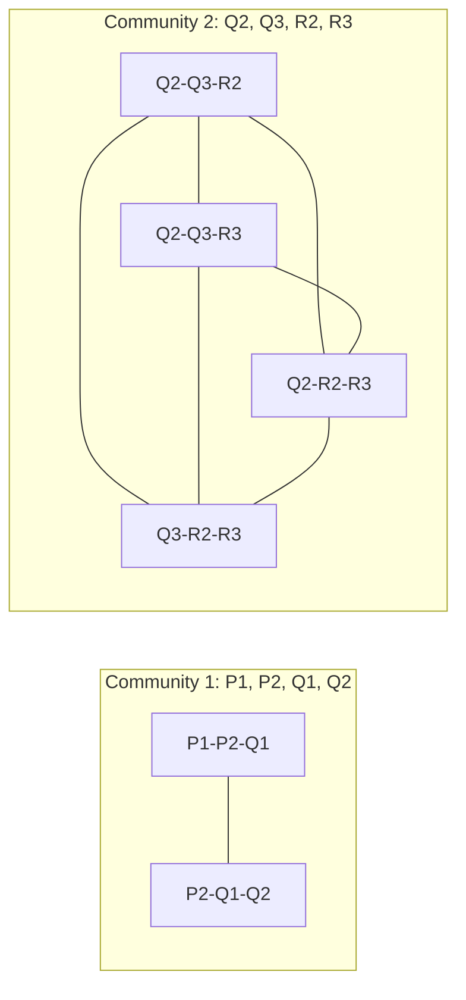

**In simple words:** **Clique Percolation Method (CPM)** chhote cliques ko jodkar communities dhoondhta hai. **$k$-clique** $k$ nodes ka wo group hai jisme har pair connected ho ($k = 3$ ke liye, ek triangle). Do $k$-cliques **adjacent** hain agar wo $k-1$ nodes share karte hain. Community wo sab kuch hai jahan adjacent $k$-cliques par hop karke pahunch sakte hain. Communities **overlap** kar sakti hain. <Cite id="social-network-graphs-palla2005" /> <Cite id="social-network-graphs-wiki-cpm" />

**Algorithm (CPM)**, graph $G$ aur integer $k$ ke liye:

1. $G$ ke saare $k$-cliques dhoondo.
2. Clique graph banao: har $k$-clique ke liye ek node, aur edge tab jab do cliques $k-1$ nodes share karein.
3. Clique graph ke connected components dhoondo.
4. Ek component ke cliques ke nodes ka union ek community hai.
5. Jo node do components ke cliques mein hai wo dono communities mein hai (overlap). Jo node kisi $k$-clique mein nahi, wo kisi mein nahi. <Cite id="social-network-graphs-cs224w-overlap" />

**Graph.** Main nodes ke naam rakhta hoon: upar ki row P1, P2, P3; beech ki row Q1, Q2, Q3; neeche R2 (Q2 ke neeche) aur R3 (Q3 ke neeche). 13 edges hain: P1-P2, P2-P3, P1-Q1, P2-Q1, P2-Q2, P3-Q3, Q1-Q2, Q2-Q3, Q2-R2, Q2-R3, Q3-R2, Q3-R3, R2-R3.

<Cite id="social-network-graphs-wiki-cpm" loc="diagram" />

<Sum>

<Given>

Upar ka graph aur $k = 3$.

</Given>

<Find>

3-cliques aur communities.

</Find>

<Steps>

1. **Saare triangles dhoondo.** \{P1, P2, Q1\}, \{P2, Q1, Q2\}, \{Q2, Q3, R2\}, \{Q2, Q3, R3\}, \{Q2, R2, R3\}, \{Q3, R2, R3\}. Kul 6. P3 kisi mein nahi, kyunki uske neighbours P2 aur Q3 aapas mein connected nahi hain.
2. **Wo triangles jodo jo $k-1 = 2$ nodes share karte hain.** \{P1, P2, Q1\} aur \{P2, Q1, Q2\} P2 aur Q1 share karte hain, isliye linked. Q2, Q3, R2, R3 ke chaaron triangles aapas mein do nodes share karte hain, isliye ek group mein jud jaate hain.
3. \{P2, Q1, Q2\} aur \{Q2, Q3, R2\} sirf Q2 share karte hain, isliye **linked nahi**.
4. **Components.** Component 1: pehle do triangles. Component 2: aakhri chaar.
5. **Unions.** Community 1 $= \{P1, P2, Q1, Q2\}$. Community 2 $= \{Q2, Q3, R2, R3\}$.

</Steps>

<Answer>

Do communities: \{P1, P2, Q1, Q2\} aur \{Q2, Q3, R2, R3\}. Q2 dono mein hai (overlap). P3 kisi community mein nahi.

</Answer>

<Box kind="verify">

\{Q2, Q3, R2, R3\} mein saari 6 possible edges hain, to ye 4-clique hai jisme $\binom{4}{3} = 4$ triangles hain. Dusre group ke 2 triangles jodo: $4 + 2 = 6$, jo step 1 se match karta hai. Degrees ka jod $2+4+2+3+5+4+3+3 = 26 = 2 \times 13$ edges, yaani koi edge chhooti nahi.

</Box>

</Sum>

<Cite id="social-network-graphs-cs224w-overlap" loc="diagram" />

**Conclusion:** CPM wo triangles jo do nodes share karte hain unhe communities mein badal deta hai, yahan do communities jo Q2 par overlap karti hain. <Cite id="social-network-graphs-networkx-kclique" />

Exam mein English mein likho: "CPM finds all k-cliques, links cliques that share k-1 nodes, and each connected group of cliques is one community."
