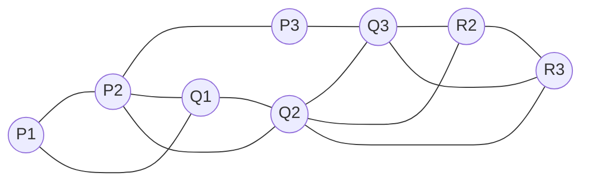
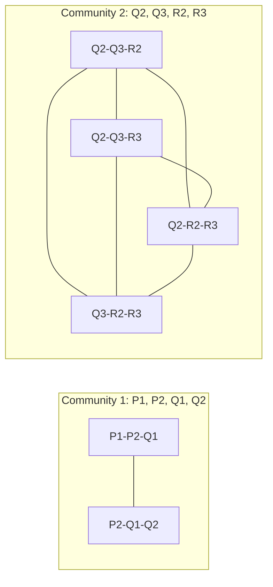

**In simple words:** the **Clique Percolation Method (CPM)** finds communities by joining small cliques. A **$k$-clique** is a group of $k$ nodes where every pair is connected (for $k = 3$, a triangle). Two $k$-cliques are **adjacent** if they share $k-1$ nodes. A community is everything reachable by hopping between adjacent $k$-cliques. Communities may **overlap**. <Cite id="social-network-graphs-palla2005" /> <Cite id="social-network-graphs-wiki-cpm" />

**Algorithm (CPM)** for graph $G$ and integer $k$:

1. Find all $k$-cliques of $G$.
2. Build a clique graph: one node per $k$-clique, with an edge when two cliques share $k-1$ nodes.
3. Find the connected components of the clique graph.
4. The union of the nodes in the cliques of one component is one community.
5. A node in cliques of two components belongs to both communities (overlap). A node in no $k$-clique belongs to none. <Cite id="social-network-graphs-cs224w-overlap" />

**The graph.** I name the nodes: top row P1, P2, P3; middle row Q1, Q2, Q3; bottom row R2 (under Q2) and R3 (under Q3). The 13 edges are P1-P2, P2-P3, P1-Q1, P2-Q1, P2-Q2, P3-Q3, Q1-Q2, Q2-Q3, Q2-R2, Q2-R3, Q3-R2, Q3-R3, R2-R3.

<Cite id="social-network-graphs-wiki-cpm" loc="diagram" />

<Sum>

<Given>

The graph above and $k = 3$.

</Given>

<Find>

the 3-cliques and the communities.

</Find>

<Steps>

1. **Find all triangles.** \{P1, P2, Q1\}, \{P2, Q1, Q2\}, \{Q2, Q3, R2\}, \{Q2, Q3, R3\}, \{Q2, R2, R3\}, \{Q3, R2, R3\}. That is 6. P3 is in none, because its neighbours P2 and Q3 are not connected.
2. **Link triangles sharing $k-1 = 2$ nodes.** \{P1, P2, Q1\} and \{P2, Q1, Q2\} share P2 and Q1, so they link. The four triangles on Q2, Q3, R2, R3 share two nodes with each other, so they link into one group.
3. \{P2, Q1, Q2\} and \{Q2, Q3, R2\} share only Q2, so they are **not** linked.
4. **Components.** Component 1: the first two triangles. Component 2: the last four.
5. **Unions.** Community 1 $= \{P1, P2, Q1, Q2\}$. Community 2 $= \{Q2, Q3, R2, R3\}$.

</Steps>

<Answer>

Two communities: \{P1, P2, Q1, Q2\} and \{Q2, Q3, R2, R3\}. Q2 is in both (overlap). P3 is in no community.

</Answer>

<Box kind="verify">

\{Q2, Q3, R2, R3\} has all 6 possible edges, so it is a 4-clique holding $\binom{4}{3} = 4$ triangles. Add the 2 triangles of the other group: $4 + 2 = 6$, matching step 1. Degrees add to $2+4+2+3+5+4+3+3 = 26 = 2 \times 13$ edges, so no edge was missed.

</Box>

</Sum>

<Cite id="social-network-graphs-cs224w-overlap" loc="diagram" />

**Conclusion:** CPM turns triangles that share two nodes into communities, here two overlapping at Q2. <Cite id="social-network-graphs-networkx-kclique" />
