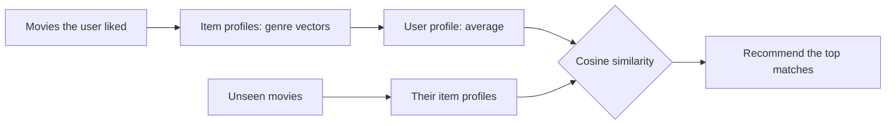

**In simple words:** a **content-based recommender** suggests items similar to the items a user liked before, where "similar" is judged from the item's own properties (genre, cast, keywords). <Cite id="recommendation-systems-mmds-slides" /> <Cite id="recommendation-systems-gfg-cb" />

**Why use it (the justification).**

- It needs **no data from other users**, so it works for a new item or a small site with few users.
- It can recommend **new and unpopular items**, because it looks at features, not at how many people rated it.
- It can **explain** itself ("because you liked sci-fi films").
- It can serve a user with **unusual tastes**.

Its limits are over-specialisation (it keeps suggesting the same kind of item), a **cold start** for a new user with no profile, and the effort of choosing good features. <Cite id="recommendation-systems-google-cb" />

**Case study: a movie streaming app.** A user has liked *Inception* and *Interstellar*. The app describes each movie by genre features, builds a user profile from the liked movies, and ranks unseen movies by similarity to it. Music services work the same way: Pandora's Music Genome Project describes songs by attributes. <Cite id="recommendation-systems-wiki-genome" />

<Cite id="recommendation-systems-gfg-cb" loc="diagram" />

<Sum>

<Given>

Features (Sci-fi, Action, Romance, Comedy). Liked: Inception $(1,1,0,0)$, Interstellar $(1,0,0,0)$. Candidates: Matrix $(1,1,0,0)$, Avengers $(0,1,0,0)$, Notebook $(0,0,1,0)$.

</Given>

<Find>

the user profile and the ranking of the candidates.

</Find>

<Steps>

1. **User profile** = average of the liked vectors $= ((1+1)/2, (1+0)/2, 0, 0) = (1, 0.5, 0, 0)$. Its length is $\sqrt{1 + 0.25} = 1.118$.
2. **Cosine** $= \dfrac{u \cdot m}{|u|\,|m|}$.
3. Matrix: $u \cdot m = 1 + 0.5 = 1.5$, $|m| = \sqrt 2 = 1.414$, so $1.5 / (1.118 \times 1.414) = 0.949$.
4. Avengers: $u \cdot m = 0.5$, $|m| = 1$, so $0.5 / 1.118 = 0.447$.
5. Notebook: $u \cdot m = 0$, so cosine $= 0$.

</Steps>

<Answer>

Rank: Matrix (0.949), then Avengers (0.447), then Notebook (0). Recommend Matrix first.

</Answer>

<Box kind="verify">

Angle check: the profile $(1, 0.5)$ is at $26.6^\circ$ and Matrix $(1, 1)$ at $45^\circ$. They differ by $18.4^\circ$ and $\cos 18.4^\circ = 0.949$. Avengers at $90^\circ$ differs by $63.4^\circ$ and $\cos 63.4^\circ = 0.447$.

</Box>

</Sum>

**Conclusion:** content-based filtering is justified where item features are available and user data is thin; it is often combined with collaborative filtering to avoid over-specialisation.
