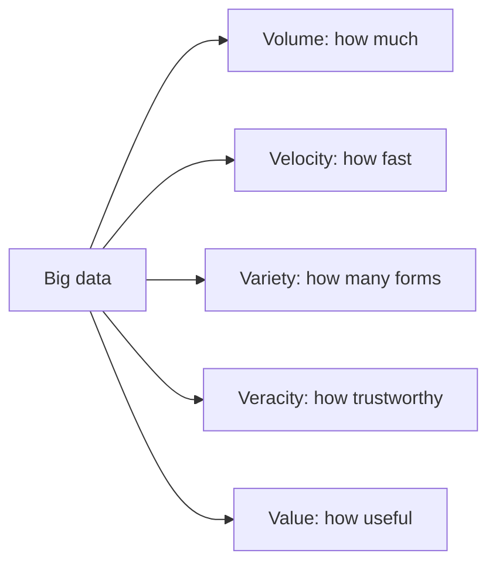

**In simple words:** big data woh data hai jo itna bada, itna fast ya itna messy hota hai ki ek normal computer aur normal database use store ya process nahi kar sakte. Ise paanch words se describe karte hain jo V se start hote hain. <Cite id="big-data-intro-ibm" /> <Cite id="big-data-intro-gfg" />

| V | Meaning | Example |
|---|---|---|
| **Volume** | Data ki matra: terabytes se petabytes. | Facebook pe roz upload hone wali photos. |
| **Velocity** | Data kitni speed se aata hai aur kitni jaldi process karna hai. | Stock ticks, sensor readings, live clicks. |
| **Variety** | Bahut saare forms: structured (tables), semi-structured (JSON, XML) aur unstructured (text, images, video). | Tweets, CCTV video, bank records. |
| **Veracity** | Data kitna trustworthy aur clean hai; noise, errors aur bias ise kam karte hain. | Fake reviews, kharab sensors. |
| **Value** | Data se milne wala useful insight ya paisa. Jo data koi decision nahi deta woh sirf kharcha hai. | Recommendations jo sales badhate hain. |

Volume, Velocity aur Variety original "3 Vs" hain; Veracity aur Value baad mein jode gaye, isliye kuch books mein zyada Vs milte hain. <Cite id="big-data-intro-aws" />

**Conclusion:** 5 Vs batate hain ki traditional tools kyun fail hote hain aur big data system ko kya handle karna padta hai: bahut data store karna, jaldi process karna, kai formats lena, data clean karna aur use value mein badalna.

Exam mein English mein likho: "The 5 Vs of big data are Volume, Velocity, Variety, Veracity and Value."
