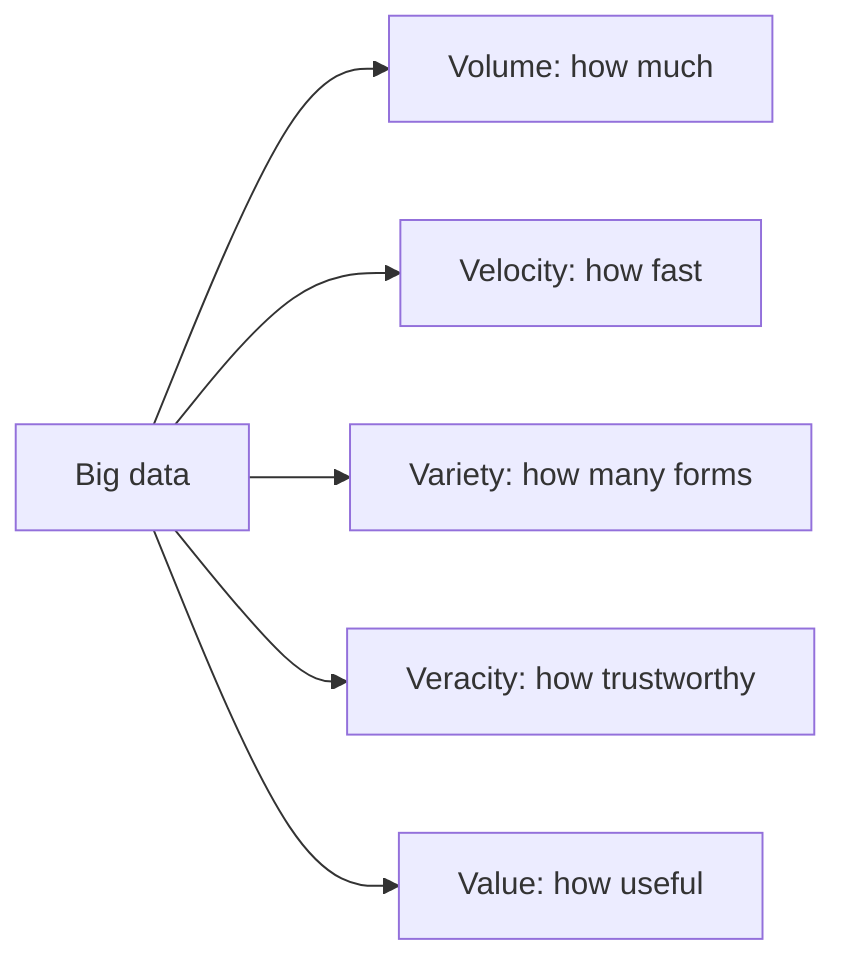

**In simple words:** big data is data so large, so fast or so messy that one ordinary computer and a normal database cannot store or process it. It is described by five words that start with V. <Cite id="big-data-intro-ibm" /> <Cite id="big-data-intro-gfg" />

| V | Meaning | Example |
|---|---|---|
| **Volume** | The amount of data: terabytes to petabytes. | Facebook photos uploaded every day. |
| **Velocity** | The speed at which data arrives and must be processed. | Stock ticks, sensor readings, live clicks. |
| **Variety** | Many forms: structured (tables), semi-structured (JSON, XML) and unstructured (text, images, video). | Tweets, CCTV video, bank records. |
| **Veracity** | How trustworthy and clean the data is; noise, errors and bias lower it. | Fake reviews, faulty sensors. |
| **Value** | The useful insight or money the data finally gives. Data that gives no decision is only cost. | Recommendations that raise sales. |

Volume, Velocity and Variety are the original "3 Vs"; Veracity and Value were added later, so some books list more than five Vs. <Cite id="big-data-intro-aws" />

**Conclusion:** the 5 Vs tell us why traditional tools fail and what a big data system must handle: store a lot, process quickly, accept many formats, clean the data and turn it into value.
