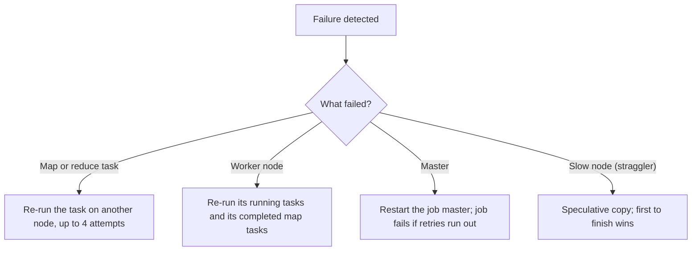

**In simple words:** MapReduce job sau-hazaaron sasti machines pe chalta hai, to kuch na kuch fail hoga hi. Framework failure detect karta hai aur khoya hua kaam dobara chalata hai, isliye user ka job phir bhi poora hota hai. <Cite id="hadoop-ecosystem-dean2004" loc="§3.3" />

1. **Task failure.** Agar map ya reduce task error de ya hang ho jaaye, framework us attempt ko failed mark karke kisi aur node pe dobara schedule karta hai. Default mein task ko 4 attempts milte hain; sab fail hon to poora job fail. <Cite id="mapreduce-apache-mapred-default" />
2. **Worker (node) failure.** Workers master ko heartbeat bhejte hain. Heartbeat band ho jaaye to node dead maana jaata hai. Uske running tasks kahin aur dobara chalte hain. Completed **map** tasks bhi dobara chalte hain, kyunki unka output us node ki local disk pe tha. Completed **reduce** output HDFS mein hai, to safe hai.
3. **Master failure.** Original paper mein master single point of failure hai aur job abort ho jaata hai. Hadoop 2 (YARN) mein ApplicationMaster restart hota hai, aur ResourceManager High Availability mode mein chal sakta hai.
4. **Stragglers.** Ek slow machine poore job ko late kar sakti hai, isliye end ke paas slow tasks ki backup copies chalti hain (speculative execution) aur jo pehle khatam ho woh use hoti hai.

Map aur reduce functions deterministic hote hain aur output tabhi commit hota hai jab task succeed ho, isliye dobara chalane se galat ya duplicate result nahi aata. <Cite id="mapreduce-gfg-mr" />

Exam mein English mein likho: "Failed tasks are re-executed on other nodes; dead workers are detected by missing heartbeats; slow tasks are handled by speculative execution."
