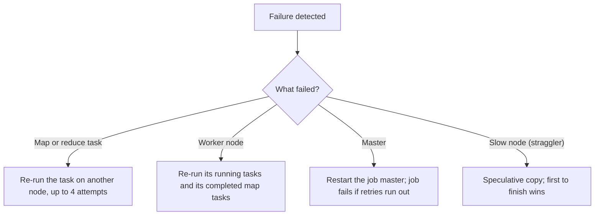

**In simple words:** a MapReduce job runs on hundreds of cheap machines, so something will fail. The framework detects failures and simply re-runs the lost work, so the user's job still finishes. <Cite id="hadoop-ecosystem-dean2004" loc="§3.3" />

1. **Task failure.** If a map or reduce task throws an error or hangs, the framework marks the attempt failed and schedules it again on another node. By default a task gets 4 attempts; if all fail, the whole job fails. <Cite id="mapreduce-apache-mapred-default" />
2. **Worker (node) failure.** Workers send heartbeats to the master. If heartbeats stop, the node is declared dead. Its running tasks are re-run elsewhere. Completed **map** tasks are also re-run, because their output sat on that node's local disk. Completed **reduce** output is already in HDFS, so it is safe.
3. **Master failure.** In the original paper the master is a single point of failure and the job is aborted. In Hadoop 2 (YARN) the ApplicationMaster is restarted, and the ResourceManager can run in High Availability mode.
4. **Stragglers.** A slow machine can delay the whole job, so near the end the framework starts backup copies of the slow tasks (speculative execution) and uses whichever finishes first.

Because map and reduce functions are deterministic and output is committed only when a task succeeds, re-running never gives wrong or duplicate results. <Cite id="mapreduce-gfg-mr" />
