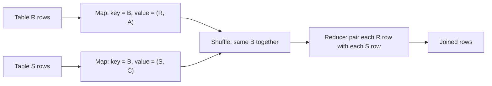

**In simple words:** relational algebra tables (relations) pe basic operations ka set hai jis par SQL bana hai. MapReduce har operation ko map step mein sahi **key** chun kar karta hai, taaki jin rows ko milna hai woh ek hi reducer pe pahunchein. <Cite id="mapreduce-algorithms-gfg-relalg" /> <Cite id="mapreduce-algorithms-wiki-relalg" />

| Operation | Meaning | Map | Reduce |
|---|---|---|---|
| Selection $\sigma_C(R)$ | Condition $C$ wali rows rakho | Row $t$ condition meet kare to emit $(t, t)$ | Identity (map-only bhi ho sakta hai) |
| Projection $\pi_S(R)$ | Chune hue columns rakho, duplicates hatao | Sirf $S$ ke columns ke saath $(t', t')$ emit | $t'$ ek hi baar emit |
| Union $R \cup S$ | Kisi bhi table ki rows | Dono tables se $(t, t)$ emit | $t$ ek baar emit |
| Intersection $R \cap S$ | Dono mein ki rows | Dono se $(t, t)$ emit | $t$ tabhi emit jab do baar aaya |
| Difference $R - S$ | $R$ mein hai, $S$ mein nahi | $(t, \text{R ya S})$ emit | $t$ tabhi emit jab sirf R hai |
| Natural join $R \bowtie S$ | Equal join value wali rows jodo | Key = join attribute, value = (table name, baaki row) | Us key ki har R row ko har S row se jodo |
| Group and aggregate $\gamma$ | Rows group karke SUM, COUNT, AVG | Key = grouping attribute, value = aggregate hone wala number | List pe aggregate lagao |

<Cite id="mapreduce-algorithms-gfg-relalg" loc="diagram" />

<Sum>

<Given>

$R(A, B)$ = (a1, b1), (a2, b1), (a3, b2). $S(B, C)$ = (b1, c1), (b2, c2), (b2, c3).

</Given>

<Find>

$R \bowtie S$ ($B$ pe join) aur har $B$ value ke liye $R$ ki rows ki sankhya (group by $B$, COUNT).

</Find>

<Steps>

1. **Join ke liye Map.** Key $B$ hai; value mein table tag aur dusra column:

   | Input row | Map output |
   |---|---|
   | R (a1, b1) | (b1, (R, a1)) |
   | R (a2, b1) | (b1, (R, a2)) |
   | R (a3, b2) | (b2, (R, a3)) |
   | S (b1, c1) | (b1, (S, c1)) |
   | S (b2, c2) | (b2, (S, c2)) |
   | S (b2, c3) | (b2, (S, c3)) |

2. **Shuffle.** b1: [(R,a1), (R,a2), (S,c1)]. b2: [(R,a3), (S,c2), (S,c3)].
3. **Reduce.** Har key ke liye har R value ko har S value se jodo: b1 se (a1,b1,c1) aur (a2,b1,c1); b2 se (a3,b2,c2) aur (a3,b2,c3).
4. **Group aur COUNT.** Map har R row ke liye (B, 1) emit karta hai; shuffle se b1: [1, 1] aur b2: [1]; reduce sum karke b1 = 2 aur b2 = 1.

</Steps>

<Answer>

$R \bowtie S$ = \{(a1,b1,c1), (a2,b1,c1), (a3,b2,c2), (a3,b2,c3)\}; counts: b1 = 2, b2 = 1.

</Answer>

<Box kind="verify">

Row count: b1 ke liye $2 \times 1 = 2$ rows; b2 ke liye $1 \times 2 = 2$ rows; total 4, jaisa upar likha. Counts ka jod $2 + 1 = 3$, yaani $R$ ki rows.

</Box>

</Sum>

**Conclusion:** selection aur projection ek-ek row pe chalte hain; join, union, difference aur grouping tab chalte hain jab shuffle related rows ko ek key ke neeche laata hai. <Cite id="hadoop-ecosystem-mmds" />

Exam mein English mein likho: "In MapReduce, join uses the join attribute as the key so that matching tuples reach the same reducer."
