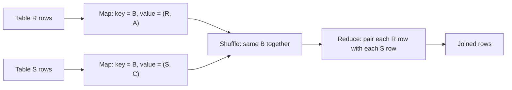

**In simple words:** relational algebra is the set of basic operations on tables (relations) that SQL is built on. MapReduce can do each of them by choosing the right **key** in the map step, so that rows that must meet land at the same reducer. <Cite id="mapreduce-algorithms-gfg-relalg" /> <Cite id="mapreduce-algorithms-wiki-relalg" />

| Operation | Meaning | Map | Reduce |
|---|---|---|---|
| Selection $\sigma_C(R)$ | Keep rows meeting condition $C$ | If row $t$ meets $C$, emit $(t, t)$ | Identity (can be map-only) |
| Projection $\pi_S(R)$ | Keep chosen columns, drop duplicates | Emit $(t', t')$ with only columns in $S$ | Emit $t'$ once |
| Union $R \cup S$ | Rows in either table | Emit $(t, t)$ from both tables | Emit $t$ once |
| Intersection $R \cap S$ | Rows in both | Emit $(t, t)$ from both | Emit $t$ only if it came twice |
| Difference $R - S$ | Rows in $R$ not in $S$ | Emit $(t, \text{R or S})$ | Emit $t$ only if just R is present |
| Natural join $R \bowtie S$ | Combine rows with equal join value | Key = join attribute, value = (table name, rest of row) | Pair every R row with every S row of that key |
| Group and aggregate $\gamma$ | Group rows, then SUM, COUNT, AVG | Key = grouping attribute, value = the number to aggregate | Apply the aggregate to the list |

<Cite id="mapreduce-algorithms-gfg-relalg" loc="diagram" />

<Sum>

<Given>

$R(A, B)$ = (a1, b1), (a2, b1), (a3, b2). $S(B, C)$ = (b1, c1), (b2, c2), (b2, c3).

</Given>

<Find>

$R \bowtie S$ (join on $B$) and the number of $R$ rows for each $B$ value (group by $B$, COUNT).

</Find>

<Steps>

1. **Map for the join.** Key is $B$; value is the table tag with the other column:

   | Input row | Map output |
   |---|---|
   | R (a1, b1) | (b1, (R, a1)) |
   | R (a2, b1) | (b1, (R, a2)) |
   | R (a3, b2) | (b2, (R, a3)) |
   | S (b1, c1) | (b1, (S, c1)) |
   | S (b2, c2) | (b2, (S, c2)) |
   | S (b2, c3) | (b2, (S, c3)) |

2. **Shuffle.** b1: [(R,a1), (R,a2), (S,c1)]. b2: [(R,a3), (S,c2), (S,c3)].
3. **Reduce.** For each key pair every R value with every S value: b1 gives (a1,b1,c1) and (a2,b1,c1); b2 gives (a3,b2,c2) and (a3,b2,c3).
4. **Group and COUNT.** Map emits (B, 1) for each R row; shuffle gives b1: [1, 1] and b2: [1]; reduce sums to b1 = 2 and b2 = 1.

</Steps>

<Answer>

$R \bowtie S$ = \{(a1,b1,c1), (a2,b1,c1), (a3,b2,c2), (a3,b2,c3)\}; counts: b1 = 2, b2 = 1.

</Answer>

<Box kind="verify">

Row count: for b1, $2 \times 1 = 2$ rows; for b2, $1 \times 2 = 2$ rows; total 4, as listed. The counts add up to $2 + 1 = 3$, the number of rows in $R$.

</Box>

</Sum>

**Conclusion:** selection and projection need only a row at a time; join, union, difference and grouping work by making the shuffle bring related rows together under one key. <Cite id="hadoop-ecosystem-mmds" />
