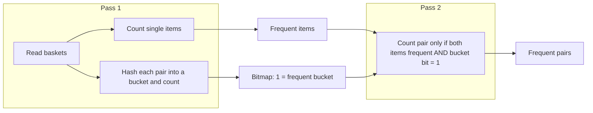

**In simple words:** PCY (Park, Chen, Yu) **frequent itemsets** dhundhta hai, jaise dukaan mein jo items aksar saath kharide jaate hain. Ye Apriori algorithm ko behtar banata hai: pehle pass mein khali padi memory mein hashed pairs ginta hai, taaki doosre pass mein ginne ke liye bahut kam pairs bachein. (Syllabus mein stream counting hai; PCY yahan poocha gaya related frequent-itemset method hai.) <Cite id="pyq-2024-12-gfg-pcy" /> <Cite id="stream-counting-wiki-apriori" />

**Ye kyun zaroori hai:** Apriori ka pass 1 sirf single items ginta hai aur bahut kam memory use karta hai, lekin pass 2 ko frequent items ka har pair ginna padta hai, jo memory ke liye bahut ho sakte hain. PCY pass 1 ki bachi memory se pass 2 ka kaam kam karta hai. <Cite id="hadoop-ecosystem-mmds" loc="§6.3.1" />

**PCY kaise kaam karta hai.** Support threshold $s$ woh minimum baskets hain jinmein itemset aana chahiye.

1. **Pass 1.** Har item ginte hain. Saath hi har basket ke har pair pe hash function lagakar us pair ke **bucket** count mein 1 jodte hain.
2. **Passes ke beech.** Count $\ge s$ wale items frequent hain. Bucket counts ko **bitmap** mein badlo: bucket count $\ge s$ (frequent bucket) to 1, warna 0. Bitmap ko har bucket ke liye sirf 1 bit chahiye, 4-byte count nahi.
3. **Pass 2.** Pair $\{i, j\}$ tabhi ginte hain jab $i$ aur $j$ dono frequent hon **aur** pair us bucket mein jaaye jiska bit 1 hai.

<Cite id="pyq-2024-12-gfg-pcy" loc="diagram" />

<Sum>

<Given>

Baskets: B1 = \{1,2,3\}, B2 = \{1,2,4\}, B3 = \{1,2\}, B4 = \{2,3,4\}, B5 = \{1,3\}. Support $s = 3$. Hash $h(i,j) = (i \times j) \bmod 5$, buckets 0 se 4.

</Given>

<Find>

frequent pairs, aur pass 2 ko kitne pairs ginne padte hain.

</Find>

<Steps>

1. **Item counts.** 1 B1, B2, B3, B5 mein = 4; 2 B1, B2, B3, B4 mein = 4; 3 B1, B4, B5 mein = 3; 4 B2, B4 mein = 2. Frequent items: 1, 2, 3.
2. **Har basket ke pairs.** B1: 12, 13, 23. B2: 12, 14, 24. B3: 12. B4: 23, 24, 34. B5: 13.
3. **Har pair ko hash karo.**

   | Pair | Kitni baar | $i \times j$ | Bucket |
   |---|---|---|---|
   | 12 | 3 | 2 | 2 |
   | 13 | 2 | 3 | 3 |
   | 23 | 2 | 6 | 1 |
   | 14 | 1 | 4 | 4 |
   | 24 | 2 | 8 | 3 |
   | 34 | 1 | 12 | 2 |

4. **Bucket counts.** Bucket 0 = 0; bucket 1 = 2 (pair 23); bucket 2 = 3 + 1 = 4 (12 aur 34); bucket 3 = 2 + 2 = 4 (13 aur 24); bucket 4 = 1 (14).
5. **Bitmap** ($s = 3$): buckets 0 se 4 ke liye 0, 0, 1, 1, 0.
6. **Pass 2 candidates.** Frequent items ke pairs 12, 13, 23 hain. Pair 12 bucket 2 mein (bit 1) to rakha; 13 bucket 3 mein (bit 1) rakha; 23 bucket 1 mein (bit 0) hata diya. Count 12 = 3 aur 13 = 2.

</Steps>

<Answer>

frequent pair: \{1, 2\} (count 3). Pass 2 ne 2 pairs gine, jabki Apriori 3 ginta.

</Answer>

<Box kind="verify">

Bucket total: $0 + 2 + 4 + 4 + 1 = 11$, jo pair occurrences $3 + 2 + 2 + 1 + 2 + 1 = 11$ ke barabar hai. Pair 12 seedha gino: B1, B2, B3 mein = 3, aur koi aur pair 3 tak nahi pahunchta (13 = 2, 23 = 2, 24 = 2), to \{1, 2\} sahi hai.

</Box>

</Sum>

**PCY ke types (variants).** Dono aur hashing se zyada pairs hatate hain: <Cite id="hadoop-ecosystem-mmds" loc="§6.3.2-6.3.3" />

| Variant | Idea | Cost |
|---|---|---|
| **Multistage** | Beech mein ek pass jodo: doosra, alag hash function sirf un pairs pe lagta hai jo frequent items ke hain aur pehli table ke frequent buckets mein girte hain; doosra bitmap banta hai. Pass 3 sirf wahi pairs ginta hai jo dono bitmaps pass karein. | Data pe ek extra pass |
| **Multihash** | Pass 1 mein do (ya zyada) hash tables, har ek mein aadhe buckets. Pair tabhi candidate hai jab har table mein frequent bucket mein ho. | Passes utne hi, lekin tables chhoti, to buckets kam bhare hone chahiye |

**Conclusion:** PCY = Apriori + pass 1 mein hash table; multistage aur multihash aur zyada pairs hatate hain.

Exam mein English mein likho: "PCY uses a hash table and bitmap in pass 1 to reduce the candidate pairs counted in pass 2."
