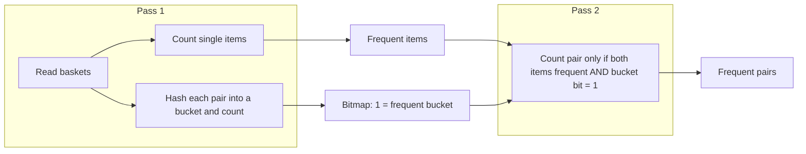

**In simple words:** PCY (Park, Chen, Yu) finds **frequent itemsets**, such as items often bought together in a shop. It improves the Apriori algorithm by using the idle memory in the first pass to count hashed pairs, so the second pass has far fewer pairs to count. (The syllabus names stream counting; PCY is the related frequent-itemset method asked here.) <Cite id="pyq-2024-12-gfg-pcy" /> <Cite id="stream-counting-wiki-apriori" />

**Why it is needed:** Apriori's pass 1 counts only single items and uses very little memory, but pass 2 must count every pair of frequent items, which can be too many for memory. PCY uses the spare memory in pass 1 to reduce pass 2's work. <Cite id="hadoop-ecosystem-mmds" loc="§6.3.1" />

**How PCY works.** The support threshold $s$ is the minimum number of baskets an itemset must appear in.

1. **Pass 1.** Count every item. Also, for every pair in every basket, apply a hash function and add 1 to that pair's **bucket** count.
2. **Between passes.** Keep items with count $\ge s$ as frequent. Turn the bucket counts into a **bitmap**: 1 if the bucket count $\ge s$ (frequent bucket), else 0. The bitmap needs only 1 bit per bucket instead of a 4-byte count.
3. **Pass 2.** Count a pair $\{i, j\}$ only if both $i$ and $j$ are frequent **and** the pair hashes to a bucket whose bit is 1.

<Cite id="pyq-2024-12-gfg-pcy" loc="diagram" />

<Sum>

<Given>

Baskets: B1 = \{1,2,3\}, B2 = \{1,2,4\}, B3 = \{1,2\}, B4 = \{2,3,4\}, B5 = \{1,3\}. Support $s = 3$. Hash $h(i,j) = (i \times j) \bmod 5$ with buckets 0 to 4.

</Given>

<Find>

the frequent pairs, and how many pairs pass 2 has to count.

</Find>

<Steps>

1. **Item counts.** 1 appears in B1, B2, B3, B5 = 4; 2 in B1, B2, B3, B4 = 4; 3 in B1, B4, B5 = 3; 4 in B2, B4 = 2. Frequent items: 1, 2, 3.
2. **Pairs per basket.** B1: 12, 13, 23. B2: 12, 14, 24. B3: 12. B4: 23, 24, 34. B5: 13.
3. **Hash every pair.**

   | Pair | Times seen | $i \times j$ | Bucket |
   |---|---|---|---|
   | 12 | 3 | 2 | 2 |
   | 13 | 2 | 3 | 3 |
   | 23 | 2 | 6 | 1 |
   | 14 | 1 | 4 | 4 |
   | 24 | 2 | 8 | 3 |
   | 34 | 1 | 12 | 2 |

4. **Bucket counts.** Bucket 0 = 0; bucket 1 = 2 (pair 23); bucket 2 = 3 + 1 = 4 (12 and 34); bucket 3 = 2 + 2 = 4 (13 and 24); bucket 4 = 1 (14).
5. **Bitmap** ($s = 3$): buckets 0 to 4 give 0, 0, 1, 1, 0.
6. **Pass 2 candidates.** Pairs of frequent items are 12, 13, 23. Pair 12 is in bucket 2 (bit 1) so it is kept; 13 in bucket 3 (bit 1) kept; 23 in bucket 1 (bit 0) is dropped. Count 12 = 3 and 13 = 2.

</Steps>

<Answer>

frequent pair: \{1, 2\} (count 3). Pass 2 counts 2 pairs instead of the 3 that Apriori would count.

</Answer>

<Box kind="verify">

Bucket total: $0 + 2 + 4 + 4 + 1 = 11$, equal to the pair occurrences $3 + 2 + 2 + 1 + 2 + 1 = 11$. Direct count of pair 12: it is in B1, B2, B3 = 3, and no other pair reaches 3 (13 = 2, 23 = 2, 24 = 2), so \{1, 2\} is right.

</Box>

</Sum>

**Types (variants) of PCY.** Both use more hashing to prune more pairs: <Cite id="hadoop-ecosystem-mmds" loc="§6.3.2-6.3.3" />

| Variant | Idea | Cost |
|---|---|---|
| **Multistage** | Add a middle pass: a second, different hash function is applied only to pairs that are of frequent items and fall in frequent buckets of the first table; a second bitmap results. Pass 3 counts only pairs passing both bitmaps. | One more pass over the data |
| **Multihash** | Use two (or more) hash tables in pass 1, each with half the buckets. A pair is a candidate only if it is in a frequent bucket in every table. | Same number of passes, but smaller tables, so buckets must be less crowded |

**Conclusion:** PCY = Apriori + a hash table in pass 1; multistage and multihash prune even more pairs.
