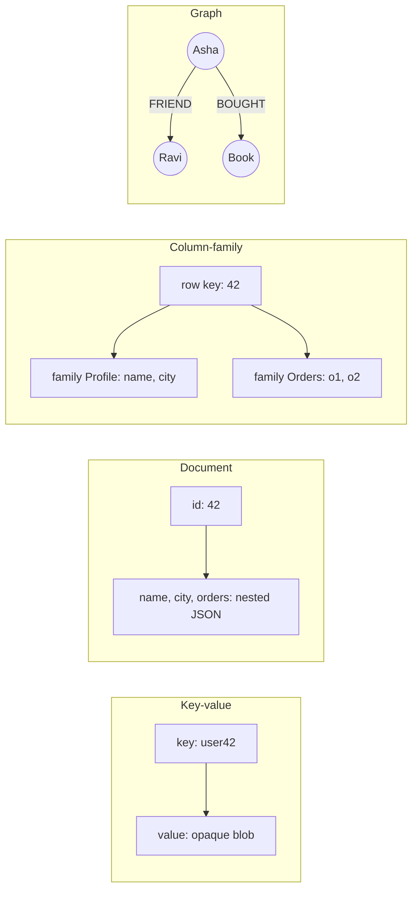

**In simple words:** architectural pattern matlab NoSQL database data ko basically kaise arrange karta hai. Chaar main patterns hain: key-value, document, column-family aur graph. Har ek alag tarah ki problem ke liye fit hai. <Cite id="nosql-patterns-gfg-types" /> <Cite id="big-data-intro-nosql" />

<Cite id="nosql-patterns-gfg-types" loc="diagram" />

| Pattern | Data kaise rakha jaata hai | Strength | Weakness | Examples aur use |
|---|---|---|---|---|
| **Key-value** | Ek unique key ek value ko point karti hai jise database andar se nahi dekhta | Bahut fast, sabse simple, aasan scaling | Value ke content se query nahi | Redis, DynamoDB: cache, sessions, shopping carts |
| **Document** | Self-describing JSON/BSON documents, nested fields ke saath | Flexible schema, fields pe rich queries, objects se match | Documents ke beech joins weak | MongoDB, CouchDB: catalogues, content, user profiles <Cite id="nosql-patterns-mongo-doc" /> |
| **Column-family (wide-column)** | Row key wali rows, columns families mein grouped, column ke hisaab se stored | Bahut nodes pe huge write load aur sparse data sambhalta hai | Query design ki hui key ke hisaab se; ad-hoc queries kam | Cassandra, HBase: logs, time series, IoT |
| **Graph** | Nodes aur edges, dono pe properties | Relationship queries fast (friends of friends) | Kai machines pe scale karna mushkil; tools kam | Neo4j: social networks, fraud detection, recommendations <Cite id="nosql-patterns-neo4j-model" /> |

**Conclusion:** speed ke liye key-value, flexible records ke liye document, massive write-heavy data ke liye column-family, aur jab relationships hi mudda ho tab graph chuno.

Exam mein English mein likho: "The four NoSQL architectural patterns are key-value, document, column-family and graph."
