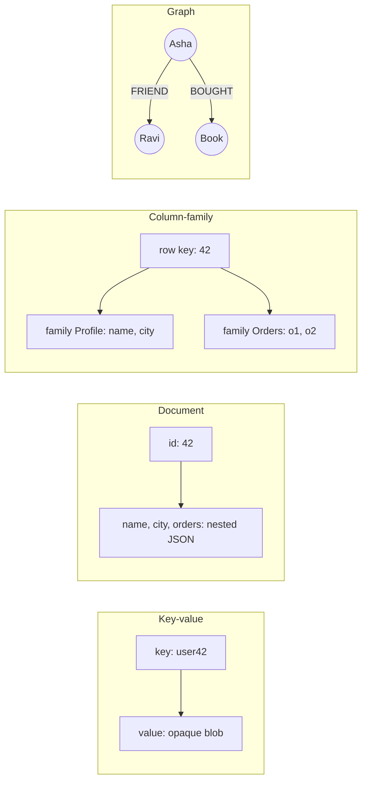

**In simple words:** an architectural pattern is the basic way a NoSQL database arranges data. There are four main patterns: key-value, document, column-family and graph. Each fits a different kind of problem. <Cite id="nosql-patterns-gfg-types" /> <Cite id="big-data-intro-nosql" />

<Cite id="nosql-patterns-gfg-types" loc="diagram" />

| Pattern | How data is held | Strength | Weakness | Examples and use |
|---|---|---|---|---|
| **Key-value** | One unique key points to a value the database does not look into | Very fast, simplest, scales easily | Cannot query by value contents | Redis, DynamoDB: cache, sessions, shopping carts |
| **Document** | Self-describing JSON/BSON documents with nested fields | Flexible schema, rich queries on fields, maps to objects | Joins across documents are weak | MongoDB, CouchDB: catalogues, content, user profiles <Cite id="nosql-patterns-mongo-doc" /> |
| **Column-family (wide-column)** | Rows with a row key, columns grouped into families, stored by column | Handles huge write loads and sparse data across many nodes | Queries must follow the designed key; limited ad-hoc queries | Cassandra, HBase: logs, time series, IoT |
| **Graph** | Nodes and edges, both with properties | Fast relationship queries (friends of friends) | Harder to scale across machines; fewer tools | Neo4j: social networks, fraud detection, recommendations <Cite id="nosql-patterns-neo4j-model" /> |

**Conclusion:** choose key-value for speed, document for flexible records, column-family for massive write-heavy data and graph when the relationships are the point.
