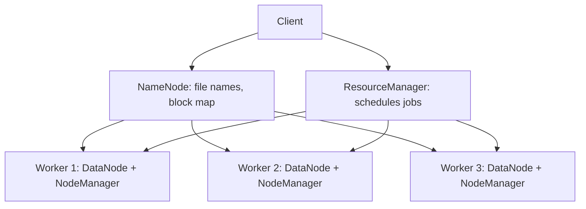

**In simple words:** Hadoop ek open-source framework hai jo bahut saari normal machines pe huge data store karta hai aur use parallel process karta hai. Iske architecture mein do core components hain: storage ke liye **HDFS** aur processing ke liye **MapReduce**, aur Hadoop 2 ke baad cluster resources **YARN** sambhalta hai. <Cite id="hadoop-ecosystem-gfg-hadoop-arch" />

<Cite id="hadoop-ecosystem-gfg-hadoop-arch" loc="diagram" />

**Component 1: HDFS (storage).** Master-worker design. <Cite id="hdfs-apache-design" />

- **NameNode (master):** namespace (directories, file names) aur ye map rakhta hai ki har file ke kaunse blocks kaunse DataNodes pe hain. Ye file ka data nahi rakhta.
- **DataNodes (workers):** blocks store karte hain, reads aur writes serve karte hain, aur NameNode ko heartbeat aur block reports bhejte hain.
- File blocks mein kat-ti hai (default 128 MB), aur har block alag nodes aur racks pe replicate hota hai (default 3 copies), to node fail hone pe data nahi jaata.
- Secondary NameNode sirf edit log ko fsimage mein merge karta hai (checkpoint); ye backup nahi hai. Standby NameNode (Hadoop 2 aur baad mein) High Availability deta hai.

**Component 2: MapReduce (processing).** Job **map** tasks mein baanta hai jo data blocks wale nodes pe chalte hain (data locality), phir **shuffle**, phir **reduce** tasks jo results combine karte hain. <Cite id="hadoop-ecosystem-dean2004" />

- Hadoop 1 mein **JobTracker** job schedule karta hai aur **TaskTrackers** tasks chalate hain.
- Hadoop 2+ mein **YARN** inki jagah leta hai: **ResourceManager** resources deta hai, har node pe **NodeManager** containers chalata hai, aur har job ka **ApplicationMaster** job chalata hai. <Cite id="hadoop-ecosystem-apache-yarn" />

**Conclusion:** HDFS data ko todkar aur replicate karke reliably store karta hai; YARN pe MapReduce computation ko data ke paas le jaata hai, isliye Hadoop scalable aur fault tolerant hai.

Exam mein English mein likho: "Hadoop has two core components: HDFS for storage and MapReduce for processing, managed by YARN."
