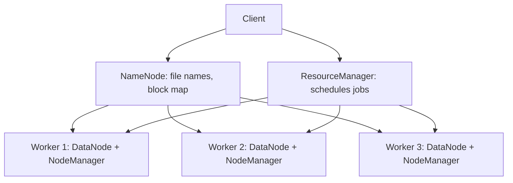

**In simple words:** Hadoop is an open-source framework that stores huge data across many ordinary machines and processes it in parallel. Its architecture has two core components: **HDFS** for storage and **MapReduce** for processing, with **YARN** managing the cluster's resources in Hadoop 2 and later. <Cite id="hadoop-ecosystem-gfg-hadoop-arch" />

<Cite id="hadoop-ecosystem-gfg-hadoop-arch" loc="diagram" />

**Component 1: HDFS (storage).** Master-worker design. <Cite id="hdfs-apache-design" />

- **NameNode (master):** keeps the namespace (directories, file names) and the map of which blocks of each file sit on which DataNodes. It holds no file data.
- **DataNodes (workers):** store the blocks, serve reads and writes, and send heartbeats and block reports to the NameNode.
- A file is cut into blocks (128 MB by default), and each block is replicated (3 copies by default) on different nodes and racks, so a failed node loses no data.
- The Secondary NameNode only merges the edit log into the fsimage (a checkpoint); it is not a backup. A Standby NameNode (Hadoop 2 and later) gives High Availability.

**Component 2: MapReduce (processing).** The job is split into **map** tasks that run on the nodes holding the data blocks (data locality), then a **shuffle**, then **reduce** tasks that combine the results. <Cite id="hadoop-ecosystem-dean2004" />

- In Hadoop 1 a **JobTracker** schedules the job and **TaskTrackers** run tasks.
- In Hadoop 2+ **YARN** replaces them: the **ResourceManager** allocates resources, a **NodeManager** on each node runs containers, and a per-job **ApplicationMaster** runs the job. <Cite id="hadoop-ecosystem-apache-yarn" />

**Conclusion:** HDFS stores data reliably by splitting and replicating it; MapReduce on YARN moves computation to the data, which makes Hadoop scalable and fault tolerant.
