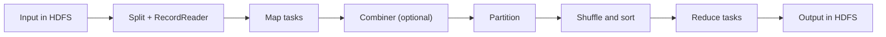

**In simple words:** MapReduce huge data set ko pieces mein baantkar har piece pe parallel kaam karta hai (map), partial results ko key ke hisaab se group karta hai (shuffle) aur har group ko combine karta hai (reduce). <Cite id="mapreduce-gfg-mr" /> <Cite id="hadoop-ecosystem-dean2004" />

**Components ke functions**

| Component | Function |
|---|---|
| **InputFormat / InputSplit** | Input file ko splits mein baantta hai, har map task ke liye ek |
| **RecordReader** | Split ko (key, value) records mein badalta hai, jaise (line offset, line text) |
| **Mapper** | User code: ek record padhta hai aur intermediate (key, value) pairs emit karta hai |
| **Combiner** (optional) | Map side ka mini-reducer jo network pe jaane wala data kam karta hai |
| **Partitioner** | Tay karta hai ki har key kaunse reducer ko jaaye, aam taur pe hash(key) mod reducers |
| **Shuffle and sort** | Map output reducers tak copy karta hai aur key ke hisaab se sort aur group karta hai |
| **Reducer** | User code: (key, values ki list) leta hai aur final result emit karta hai |
| **OutputFormat / RecordWriter** | Final output HDFS mein likhta hai |

<Cite id="hadoop-ecosystem-apache-mr-tutorial" />

**Execution steps**

1. Client job submit karta hai; input splits mein baant jaata hai.
2. Har split ek map task ko jaata hai, behtar hai us node pe jahan data hai. RecordReader records Mapper ko deta hai.
3. Mappers intermediate pairs emit karte hain; combiner unhe local level pe chhota karta hai.
4. Partitioner har key ko ek reducer ko bhejta hai.
5. Reducers apna data laate hain (shuffle), sort karte hain aur key ke hisaab se group karte hain.
6. Reduce function har key ke liye ek baar chalta hai aur output HDFS mein likha jaata hai.

**Example (word count).** Input lines: "deer bear river", "car car river", "deer car bear".

| Stage | Result |
|---|---|
| Map | (deer,1) (bear,1) (river,1) (car,1) (car,1) (river,1) (deer,1) (car,1) (bear,1) |
| Shuffle | bear: [1,1], car: [1,1,1], deer: [1,1], river: [1,1] |
| Reduce | bear 2, car 3, deer 2, river 2 |

Check: $2 + 3 + 2 + 2 = 9$, input ke words ki sankhya.

**Conclusion:** programmer sirf map aur reduce likhta hai; splitting, shuffling, scheduling aur fault handling framework karta hai. <Cite id="mapreduce-av" />

Exam mein English mein likho: "MapReduce execution: input split, map, combine, partition, shuffle and sort, reduce, output."
