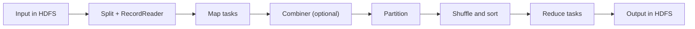

**In simple words:** MapReduce processes a huge data set by splitting it into pieces, working on every piece in parallel (map), grouping the partial results by key (shuffle) and combining each group (reduce). <Cite id="mapreduce-gfg-mr" /> <Cite id="hadoop-ecosystem-dean2004" />

**Functions of the components**

| Component | Function |
|---|---|
| **InputFormat / InputSplit** | Divides the input file into splits, one per map task |
| **RecordReader** | Turns a split into (key, value) records, e.g. (line offset, line text) |
| **Mapper** | User code: reads one record and emits intermediate (key, value) pairs |
| **Combiner** (optional) | A mini-reducer on the map side that cuts the data sent over the network |
| **Partitioner** | Decides which reducer gets each key, usually hash(key) mod number of reducers |
| **Shuffle and sort** | Copies map output to reducers and sorts and groups it by key |
| **Reducer** | User code: receives (key, list of values) and emits the final result |
| **OutputFormat / RecordWriter** | Writes the final output to HDFS |

<Cite id="hadoop-ecosystem-apache-mr-tutorial" />

**Execution steps**

1. The client submits the job; the input is divided into splits.
2. Each split goes to a map task, preferably on the node holding the data. The RecordReader feeds records to the Mapper.
3. Mappers emit intermediate pairs; the combiner shrinks them locally.
4. The partitioner sends each key to one reducer.
5. Reducers fetch their data (shuffle), sort it and group by key.
6. The reduce function runs once per key and the output is written to HDFS.

**Example (word count).** Input lines: "deer bear river", "car car river", "deer car bear".

| Stage | Result |
|---|---|
| Map | (deer,1) (bear,1) (river,1) (car,1) (car,1) (river,1) (deer,1) (car,1) (bear,1) |
| Shuffle | bear: [1,1], car: [1,1,1], deer: [1,1], river: [1,1] |
| Reduce | bear 2, car 3, deer 2, river 2 |

Check: $2 + 3 + 2 + 2 = 9$, the number of words in the input.

**Conclusion:** the programmer writes only map and reduce; the framework does splitting, shuffling, scheduling and fault handling. <Cite id="mapreduce-av" />
