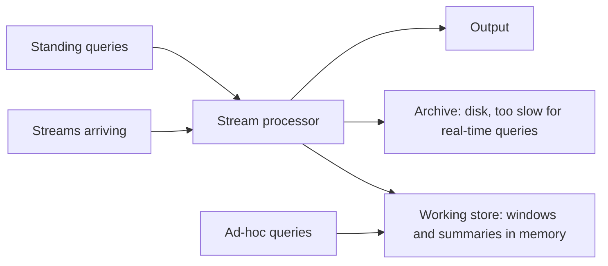

**In simple words:** data stream woh data hai jo lagatar aata rehta hai, shayad hamesha, jaise clicks, sensor readings ya tweets. System sab kuch store nahi kar sakta aur do baar padh bhi nahi sakta, isliye stream queries mein khaas problems aati hain. <Cite id="stream-data-model-wiki-ds" /> <Cite id="stream-data-model-babcock2002" />

**Data stream queries ke issues**

1. **Standing aur ad-hoc queries.** Standing query (jaise "temperature 40 se upar jaaye to batao") lagatar chalti hai, to har naye item ke saath answer update hona chahiye. Ad-hoc query kabhi bhi past ke baare mein poochi ja sakti hai, lekin purana data store nahi hota, isliye pehle se tay karna padta hai ki kya rakhna hai.
2. **Sirf recent data matter karta hai.** Queries aksar **sliding window** (last N items ya last ghanta) pe hoti hain, aur purane items expire hone par window maintain karni padti hai.
3. **Answers approximate hote hain.** Exact answers (distinct counts, 1-in-100 sample) ke liye memory bahut chahiye, isliye sampling, Bloom filters aur sketches known error ke saath approximate answer dete hain. <Cite id="stream-data-model-babcock2002" />
4. **Blocking operators.** Sort ya join jaise operators ko output dene se pehle poora input chahiye, jo kabhi khatam na hone wali stream nahi de sakti.

**Data streaming (stream processing) ke issues**

| Issue | Problem kyun hai |
|---|---|
| **Unbounded size** | Stream khatam nahi hoti, to poori store nahi ho sakti |
| **Single pass** | Har item ek baar dikhta hai; peeche nahi ja sakte |
| **Limited memory** | Main memory mein sirf chhota summary aata hai |
| **High speed** | Items disk likhne ya slow algorithm se zyada tez aate hain |
| **Real-time answers** | Results turant chahiye; lambe batch jobs ka time nahi |
| **Out-of-order, late ya bursty data** | Items late ya order ke bina aate hain, achanak bheed lagti hai; load badalta rehta hai |
| **Noise aur quality** | Missing ya galat values ko turant sambhalna padta hai |

**Conclusion:** streams fast, endless aur ek baar dikhne wali hoti hain, isliye stream systems chhote summaries aur windows rakhte hain aur exact ke bajay approximate answer dete hain. <Cite id="stream-data-model-gfg-dbms-dsms" />

Exam mein English mein likho: "Stream data is unbounded, arrives fast, can be read only once and must be processed in limited memory, so approximate answers over windows are used."
