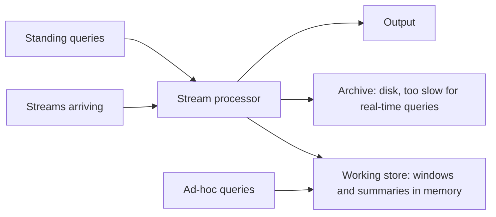

**In simple words:** a data stream is data that keeps arriving, possibly forever, such as clicks, sensor readings or tweets. A system cannot store it all or read it twice, so queries on streams raise special problems. <Cite id="stream-data-model-wiki-ds" /> <Cite id="stream-data-model-babcock2002" />

**Issues in data stream queries**

1. **Standing and ad-hoc queries.** A standing query (for example "report if the temperature exceeds 40") runs continuously, so its answer must be updated with every new item. An ad-hoc query is asked at any time about the past, but old data is not stored, so we must decide in advance what to keep.
2. **Only recent data matters.** Queries are often about a **sliding window** (the last N items or last hour), and the window must be maintained as old items expire.
3. **Answers must be approximate.** Exact answers (distinct counts, a 1-in-100 sample) need too much memory, so sampling, Bloom filters and sketches give approximate answers with known error. <Cite id="stream-data-model-babcock2002" />
4. **Blocking operators.** Operators such as sort or a join need all input before output, which a never-ending stream cannot give.

**Issues in data streaming (processing the stream)**

| Issue | Why it is a problem |
|---|---|
| **Unbounded size** | The stream never ends, so it cannot be stored in full |
| **Single pass** | Each item is seen once; no going back |
| **Limited memory** | Only a small summary fits in main memory |
| **High speed** | Items arrive faster than a disk can write or a slow algorithm can process |
| **Real-time answers** | Results are needed within moments; no time for long batch jobs |
| **Out-of-order, late or bursty data** | Items may arrive late or in sudden floods; the load changes |
| **Noise and quality** | Missing or wrong values must be handled on the fly |

**Conclusion:** because streams are fast, endless and seen once, stream systems keep small summaries and windows and give approximate answers instead of exact ones. <Cite id="stream-data-model-gfg-dbms-dsms" />
