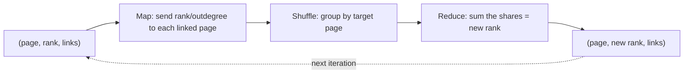

**In simple words:** PageRank web page ko is hisaab se score deta hai ki ek random surfer, jo links click karta rehta hai, us page pe kitna probable hai. Page tab important hai jab important pages uska link dein. Har page apna rank apne linked pages mein barabar baant deta hai, aur ye tab tak dohraya jaata hai jab tak scores badalna band na kar dein. <Cite id="mapreduce-algorithms-wiki-pagerank" /> <Cite id="pagerank-cs246-pagerank" />

**MapReduce kyun:** web mein arbon pages hain, to rank vector aur link matrix ek machine pe nahi aate. PageRank ka ek iteration matrix-vector multiplication $v' = Mv$ hai, jo MapReduce achhe se karta hai. <Cite id="mapreduce-algorithms-gfg-pagerank" />

**MapReduce mein ek iteration**

- **Map:** page $p$ jiska rank $r$ hai aur $d$ outgoing links pages $q_1 \dots q_d$ ko hain, har ek ke liye $(q_i, r/d)$ emit karo, aur $(p, \text{uski link list})$ bhi emit karo taaki graph agle round ke liye bacha rahe.
- **Shuffle:** ek page $q$ ki saari values ek reducer pe milti hain.
- **Reduce:** aane wali values jodo to $q$ ka naya rank milta hai, aur $(q, \text{new rank}, \text{link list})$ likho.
- Tab tak dohrao jab tak ranks bahut kam na badlein.

<Sum>

<Given>

Pages A, B, C; links A se B, C; B se C; C se A. Shuru mein har ka rank $1/3$.

</Given>

<Find>

2 iterations ke baad ranks.

</Find>

<Steps>

1. **Map, iteration 1.** A (1/3, 2 links) B ko 1/6 aur C ko 1/6 bhejta hai. B (1/3, 1 link) C ko 1/3 bhejta hai. C (1/3, 1 link) A ko 1/3 bhejta hai.

   | Key | Mili values | Reduce sum |
   |---|---|---|
   | A | 1/3 | 1/3 |
   | B | 1/6 | 1/6 |
   | C | 1/6, 1/3 | 1/2 |

2. **Iteration 2** $(1/3, 1/6, 1/2)$ se: A ko C ka poora rank milta hai, $1/2$. B ko A ka aadha, $1/6$. C ko A ka aadha plus B ka poora: $1/6 + 1/6 = 1/3$.

</Steps>

<Answer>

1 iteration ke baad $(1/3, 1/6, 1/2)$; 2 iterations ke baad (A, B, C) ke liye $(1/2, 1/6, 1/3)$.

</Answer>

<Box kind="verify">

Total har baar 1 rehta hai: $1/3 + 1/6 + 1/2 = 1$ aur $1/2 + 1/6 + 1/3 = 1$. Limit $v = Mv$ solve karti hai: $A = C$, $B = A/2$, $C = A/2 + B$ se $(0.4, 0.2, 0.4)$ aata hai, jiska sum 1 hai, aur ranks usi ki taraf ja rahe hain.

</Box>

</Sum>

**Dead ends aur spider traps** <Cite id="pagerank-wiki-spidertrap" />

| | Dead end | Spider trap |
|---|---|---|
| Kya hai | Aisa page jisme koi outgoing link nahi | Pages ka group jinke links sirf group ke andar jaate hain (ek page apne aap ko link kare tab bhi) |
| Effect | Rank andar aata hai aur gayab ho jaata hai; aakhir mein sab ranks 0 | Group saara rank kheench leta hai; baaki web 0 ho jaata hai |
| Example | A se B, B se C, C ka koi link nahi: 1/3 se shuru, ranks (0, 1/3, 1/3), phir (0, 0, 1/3), phir 0 | A se B, B se C, C se C: ranks (0, 1/3, 2/3), phir (0, 0, 1) |
| Fix | Dead ends hatao, ya unhe har page ko link karne wala maano | **Taxation** (teleportation) |

**Taxation:** probability $\beta$ (lagbhag 0.8 se 0.9) se surfer link follow karta hai, warna random page pe kood jaata hai: $v' = \beta M v + (1-\beta)\,e/n$. Upar ke spider trap ke liye $\beta = 0.8$ ke saath pehla round $(0.067, 0.333, 0.600)$ deta hai, jo ab bhi 1 ka sum hai, to trap sab kuch nahi le jaata.

**Conclusion:** PageRank baar-baar matrix-vector multiplication hai jo MapReduce rounds mein hota hai, aur taxation dead ends aur spider traps ko ranks bigaadne se rokta hai.

Exam mein English mein likho: "A dead end has no outgoing links; a spider trap is a group of pages that link only among themselves; taxation solves both."
