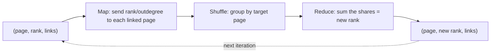

**In simple words:** PageRank scores a web page by how likely a random surfer, who keeps clicking links, is to be on it. A page is important if important pages link to it. Each page splits its rank equally among the pages it links to, and this is repeated until the scores stop changing. <Cite id="mapreduce-algorithms-wiki-pagerank" /> <Cite id="pagerank-cs246-pagerank" />

**Why MapReduce:** the web has billions of pages, so the rank vector and link matrix cannot fit on one machine. One PageRank iteration is a matrix-vector multiplication $v' = Mv$, which MapReduce does well. <Cite id="mapreduce-algorithms-gfg-pagerank" />

**One iteration in MapReduce**

- **Map:** for a page $p$ with rank $r$ and $d$ outgoing links to pages $q_1 \dots q_d$, emit $(q_i, r/d)$ for each, and also emit $(p, \text{its link list})$ so the graph is kept for the next round.
- **Shuffle:** all values for one page $q$ meet at one reducer.
- **Reduce:** add up the incoming values to get $q$'s new rank, and write $(q, \text{new rank}, \text{link list})$.
- Repeat the job until ranks change very little.

<Sum>

<Given>

Pages A, B, C with links A to B, C; B to C; C to A. Start rank $1/3$ each.

</Given>

<Find>

ranks after 2 iterations.

</Find>

<Steps>

1. **Map, iteration 1.** A (1/3, 2 links) sends 1/6 to B and 1/6 to C. B (1/3, 1 link) sends 1/3 to C. C (1/3, 1 link) sends 1/3 to A.

   | Key | Values received | Reduce sum |
   |---|---|---|
   | A | 1/3 | 1/3 |
   | B | 1/6 | 1/6 |
   | C | 1/6, 1/3 | 1/2 |

2. **Iteration 2** from $(1/3, 1/6, 1/2)$: A gets all of C's rank, $1/2$. B gets half of A's, $1/6$. C gets half of A's plus all of B's: $1/6 + 1/6 = 1/3$.

</Steps>

<Answer>

after 1 iteration $(1/3, 1/6, 1/2)$; after 2 iterations $(1/2, 1/6, 1/3)$ for (A, B, C).

</Answer>

<Box kind="verify">

The total stays 1 each time: $1/3 + 1/6 + 1/2 = 1$ and $1/2 + 1/6 + 1/3 = 1$. The limit solves $v = Mv$: $A = C$, $B = A/2$, $C = A/2 + B$ gives $(0.4, 0.2, 0.4)$, which sums to 1, and the ranks are moving towards it.

</Box>

</Sum>

**Dead ends and spider traps** <Cite id="pagerank-wiki-spidertrap" />

| | Dead end | Spider trap |
|---|---|---|
| What it is | A page with no outgoing links | A group of pages whose links only point inside the group (even one page linking to itself) |
| Effect | Rank flows in and then vanishes; eventually all ranks go to 0 | The group collects all the rank; the rest of the web goes to 0 |
| Example | A to B, B to C, C has no links: starting at 1/3 each, ranks become (0, 1/3, 1/3), then (0, 0, 1/3), then 0 | A to B, B to C, C to C: ranks become (0, 1/3, 2/3), then (0, 0, 1) |
| Fix | Drop dead ends, or treat them as linking to every page | **Taxation** (teleportation) |

**Taxation:** with probability $\beta$ (about 0.8 to 0.9) the surfer follows a link, otherwise jumps to a random page: $v' = \beta M v + (1-\beta)\,e/n$. For the spider trap above with $\beta = 0.8$ the first round gives $(0.067, 0.333, 0.600)$, which still sums to 1, so the trap no longer takes everything.

**Conclusion:** PageRank is repeated matrix-vector multiplication done as MapReduce rounds, and taxation keeps dead ends and spider traps from ruining the ranks.
