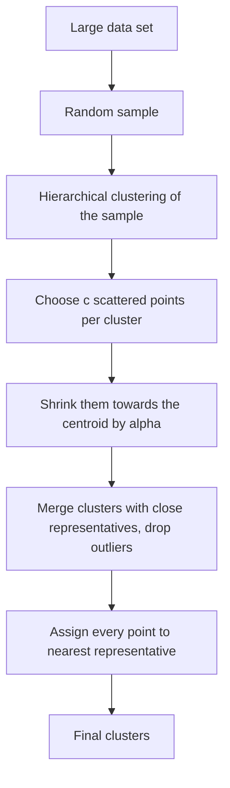

**In simple words:** CURE (Clustering Using REpresentatives) points ko clusters mein group karta hai. Cluster ko ek centre point se (k-means jaise) ya saare points se describe karne ke bajay CURE kuch well-spread **representative points** use karta hai, jinhe centre ki taraf thoda khiska diya jaata hai. Isse woh kisi bhi shape ke clusters dhundh leta hai aur outliers ko ignore karta hai. <Cite id="cure-stream-clustering-guha1998" /> <Cite id="cure-stream-clustering-tp-cure" />

**Ye kyun zaroori hai:** k-means sirf gol aur lagbhag barabar size ke clusters dhundhta hai aur outliers se khinch jaata hai; hierarchical clustering bade data ke liye bahut slow hai. CURE dono problems theek karta hai.

**Steps**

1. Data ka random **sample** lo taaki memory mein aa jaaye (bahut bade data mein sample ko bhi partition karte hain).
2. **Sample ko cluster karo** hierarchical (agglomerative) clustering se: har point ek cluster, phir sabse paas wali jodi ko baar-baar merge karo.
3. **Representatives chuno:** har cluster ke liye $c$ well-scattered points (pehla centroid se sabse door, agla pehle chune hue points se sabse door, aise hi).
4. Har representative ko cluster centroid ki taraf fraction $\alpha$ (jaise 0.2) se **shrink** karo. Isse outliers ka asar kam hota hai.
5. Do clusters **merge** karo agar unke koi representatives paas hon; representatives dobara nikalo. Bahut chhote, dheere badhne wale clusters ko outliers maanke hata do.
6. **Poora data label karo:** full data set ka har point apne nearest representative ke cluster mein jaata hai.

<Cite id="cure-stream-clustering-gfg-cure" loc="diagram" />

**Traditional clustering ke upar advantages**

| Point | k-means / centroid methods | CURE |
|---|---|---|
| Cluster shape | Sirf gol (spherical) | Arbitrary shapes, jaise lambe ya ring jaise clusters |
| Cluster size | Similar sizes pasand | Alag-alag sizes sambhalta hai |
| Outliers | Centroid ko kheenchte hain | Shrinking aur outlier removal se asar kam |
| Large data | Poore data pe kai passes | Sample plus ek labelling pass |
| Representation | Ek centre | Cluster ke kai representatives |

**Limitation:** ise parameters $c$, $\alpha$ aur sample size chahiye, aur ye Euclidean space mein kaam karta hai. <Cite id="hadoop-ecosystem-mmds" />

**Conclusion:** shrunken representative points aur sampling se CURE ajeeb shapes pe zyada accurate, outliers ke saamne robust aur scalable hai.

Exam mein English mein likho: "CURE represents each cluster by well-scattered points shrunk towards the centroid, so it finds non-spherical clusters and resists outliers."
